# Captures du TP final

Chaque étape est réalisée en ligne de commande (poste, GitHub CLI, CloudShell) ou par la pipeline.
Le numéro de compte AWS est masqué sur toutes les captures.

## Gate G0 · socle du projet (dépôt, pipeline, OIDC)

**Figure 1** · arborescence du dépôt : templates, parameters, policies, app, k8s, tests, scripts, sbom, docs, .github/workflows

**Figure 2** · 18 tests unitaires verts, couverture 97,9 % (seuil 80 %)

**Figure 3** · qualité : ruff (lint et format) et cfn-lint sans erreur

**Figure 4** · sécurité statique en local : checkov 285 contrôles réussis (CloudFormation, Kubernetes, Dockerfile), aucun chevauchement de CIDR

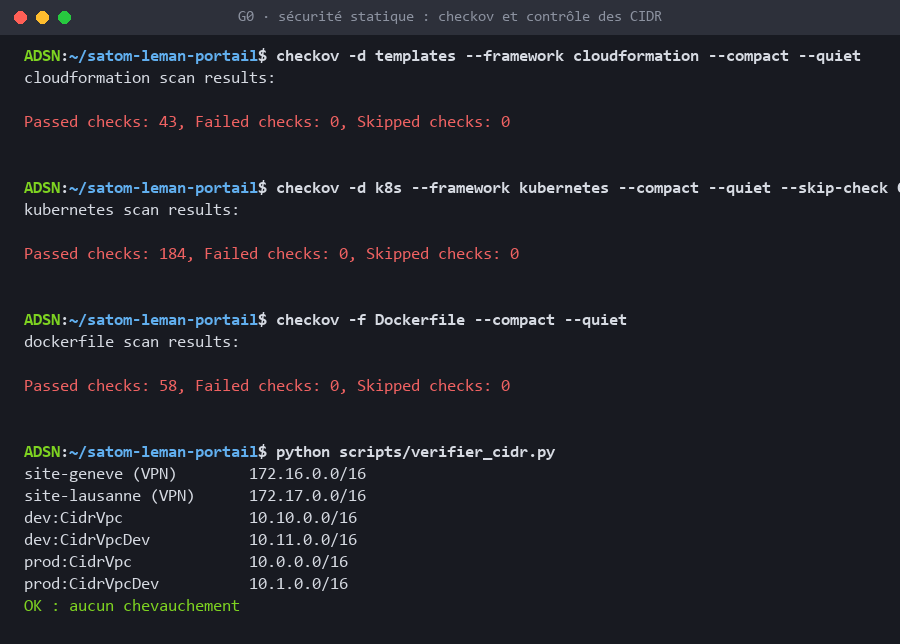

**Figure 5** · création du dépôt public AlessandroDeSousaNunes/satom-leman-portail avec gh et premier commit

**Figure 6** · protection de main : ruleset (pull request, historique linéaire, 3 vérifications obligatoires), secret scanning et push protection, alertes Dependabot

**Figure 7** · environnements dev et prod, prod soumis à la validation manuelle d'AlessandroDeSousaNunes

**Figure 8** · branche feat/g0-socle, 5 commits au format Conventional Commits, push

**Figure 9** · première exécution : qualité verte, sécurité en échec (version de l'action Trivy introuvable), étapes suivantes bloquées

**Figure 10** · correction : versions publiées des actions GitHub, commit fix(ci)

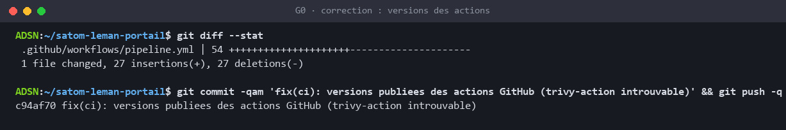

**Figure 11** · SCA : pip-audit bloque la pipeline sur Flask 3.1.2 (PYSEC-2026-2151), passage en 3.1.3, plus aucune vulnérabilité

**Figure 12** · pull request #1 : étapes 1 à 3 vertes (qualité, sécurité statique, image + SBOM), 3 artefacts ; étapes 4 à 7 réservées à main

**Figure 13** · vérifications de la pull request #1 au vert puis fusion squash dans main

**Figure 14** · exécution sur main après fusion : étapes 1 à 3 vertes, étapes AWS en attente de la variable AWS_DEPLOIEMENT

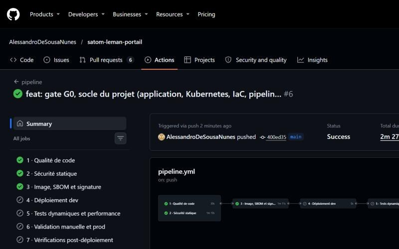

**Figure 15** · image publiée sur ghcr.io, signature cosign vérifiée (journal de transparence), SBOM CycloneDX de 2784 composants

**Figure 16** · jeu de modifications de la pile portail-bootstrap : 2 rôles IAM ajoutés (fournisseur OIDC GitHub existant réutilisé)

**Figure 17** · portail-bootstrap CREATE_COMPLETE : role-gha-portail-ADSN limité au dépôt (main, environnements dev et prod) et role-cfn-portail-ADSN

**Figure 18** · diagnostic : fournisseur OIDC GitHub du compte correct (audience sts.amazonaws.com)

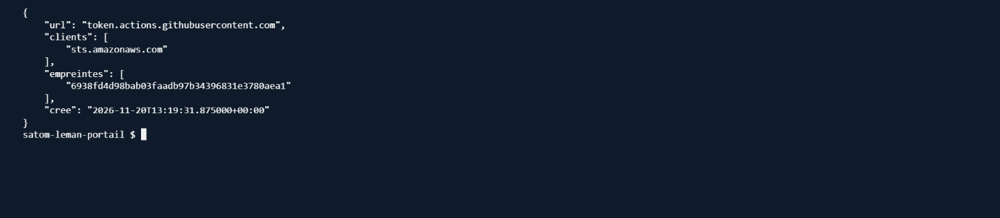

**Figure 19** · correction : le rôle accepte le claim sub avec identifiants immuables (propriétaire@260914278, dépôt@1468484199), mise à jour sans remplacement

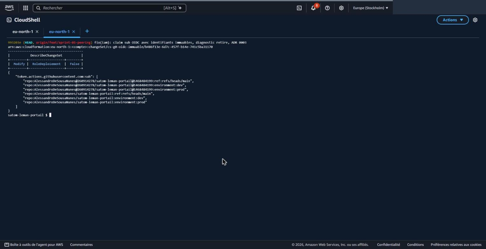

## Nettoyage du labo de la semaine (avant le TP final)

**Figure 20** · inventaire avant : ressources ADSN encore actives depuis vendredi (NAT, TGW, VPN, pare-feu, 2 ALB, instances, zones, CloudFront)

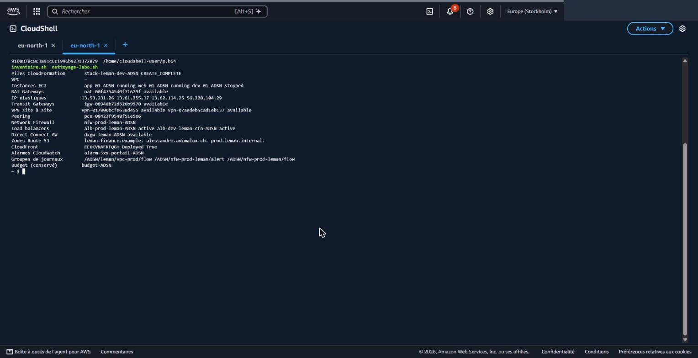

**Figure 21** · essai à blanc : uniquement des ressources étiquetées Equipe=ADSN, aucune ressource d'une autre équipe

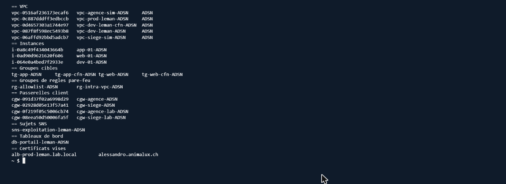

**Figure 22** · journal du script : suppression dans l'ordre des dépendances

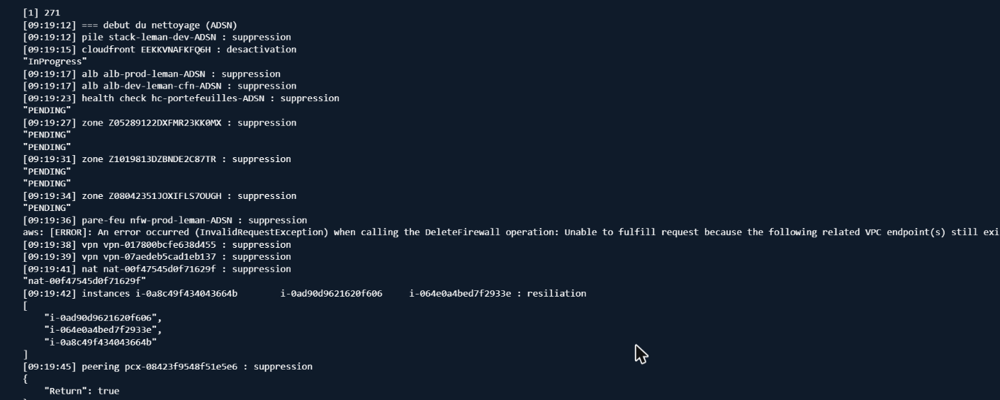

**Figure 23** · inventaire après : toutes les ressources ADSN supprimées sauf le pare-feu (erreur interne AWS, nouvelle tentative toutes les 2 minutes), budget conservé

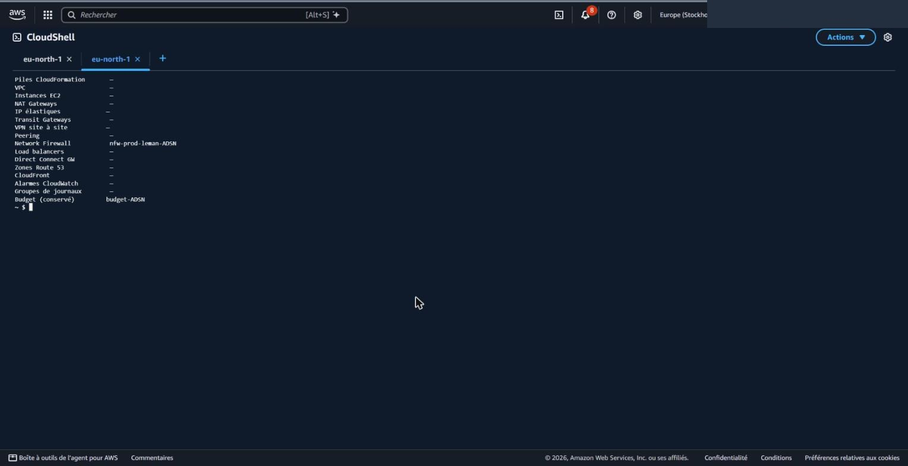

**Figure 24** · les 4 pare-feu du compte (ADSN et 3 autres équipes) restent bloqués en « Synchronisation en cours »

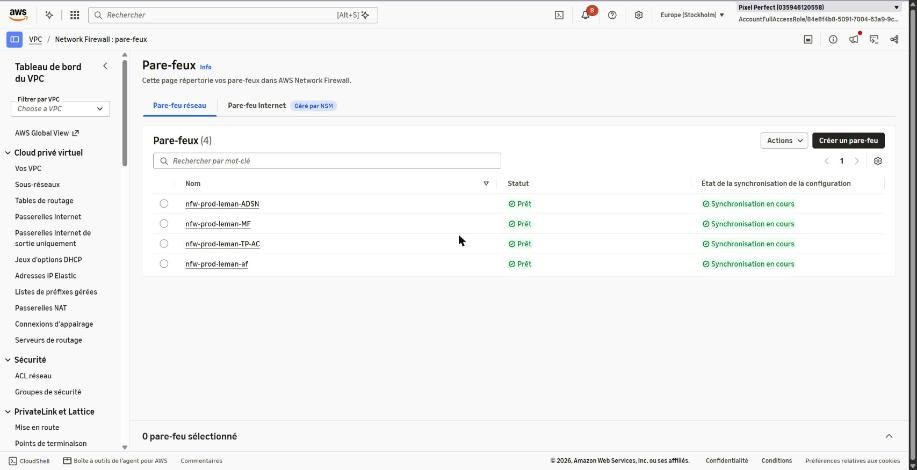

**Figure 25** · suppression de nfw-prod-leman-ADSN par la console : « Internal failure », même erreur qu'en ligne de commande (incident côté AWS)

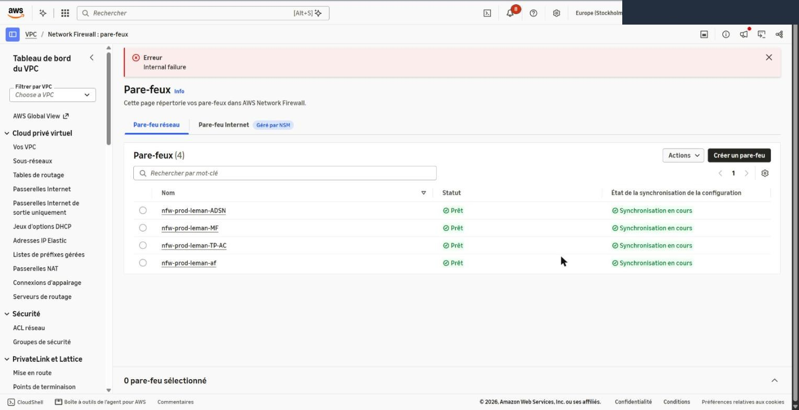

**Figure 26** · 24.11 : le pare-feu est READY et IN_SYNC, la suppression renvoie toujours « Internal failure »

## Sprints 1 à 3 · VPC, routage, Security Groups et NACL

**Figure 27** · pull request #8 verte, activation du déploiement AWS (AWS_DEPLOIEMENT=true) et fusion

**Figure 28** · étape 4 de la pipeline : piles dev créées par jeux de modifications (réseau, sécurité, sortie Internet), étape 6 en attente de validation

**Figure 29** · étape 6 : mise en prod refusée par le relecteur, reportée au sprint 13 (la porte d'approbation fonctionne)

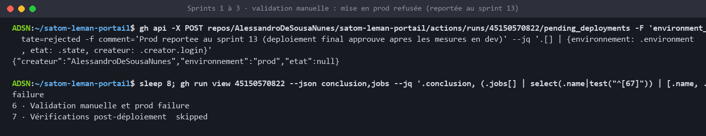

**Figure 30** · mesure : describe-subnets sur vpc-portail-dev-ADSN, sous-réseaux publics et privés sur deux zones, sub-public-1b en 10.10.5.0/24, aucune IP publique automatique

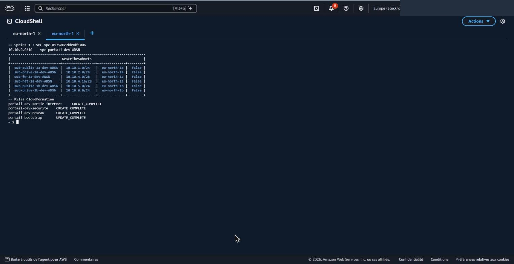

**Figure 31** · mesure : table privée sans route vers l'IGW, groupes de sécurité (SSH seulement depuis la salle, 8080 seulement depuis sg-web), NACL

## Sprints 5 à 7 (socle commun) puis sprint 5 · peering VPC

**Figure 32** · pull request #11 mise à jour avec main, fichiers modifiés (templates 04 à 06, paramètres, bootstrap)

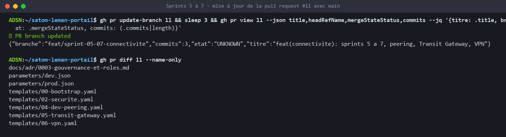

**Figure 33** · la protection de main refuse la fusion : l'étape 2 (sécurité) est en échec

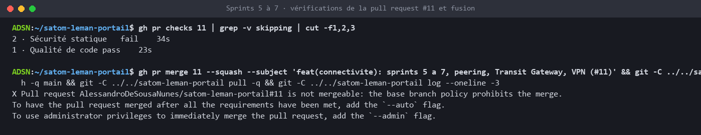

**Figure 34** · cause : la règle cfn-guard exigeait des règles d'entrée même sur dev-sg, qui n'en a volontairement aucune

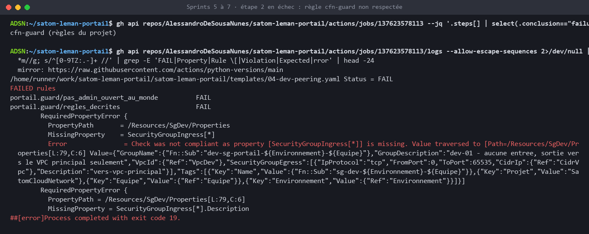

**Figure 35** · correction : la règle ne vérifie que les groupes ayant des règles d'entrée

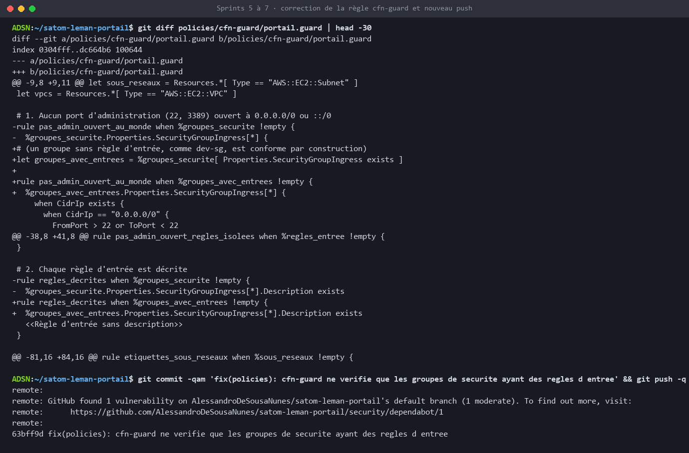

**Figure 36** · pull request #11 verte puis fusionnée

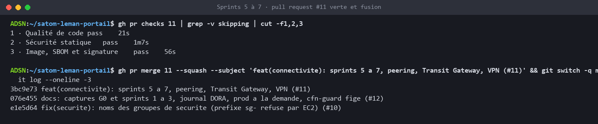

**Figure 37** · étape 4 : le script de déploiement refuse un remplacement non confirmé (journal de flux, Replacement=Conditional)

**Figure 38** · exécution automatique annulée, relance manuelle avec confirmation du remplacement relu (journal de flux)

**Figure 39** · étape 4 avec confirmation : journal de flux remplacé, sujet SNS ajouté, VPC dev, peering pcx-0267… et instances web-01, app-01, dev-01 créés en 42 s

**Figure 40** · première mesure Reachability Analyzer : les 4 analyses échouent côté AWS (internal error) ; le script les comptait à tort comme « bloqué », il est corrigé pour signaler ECHEC

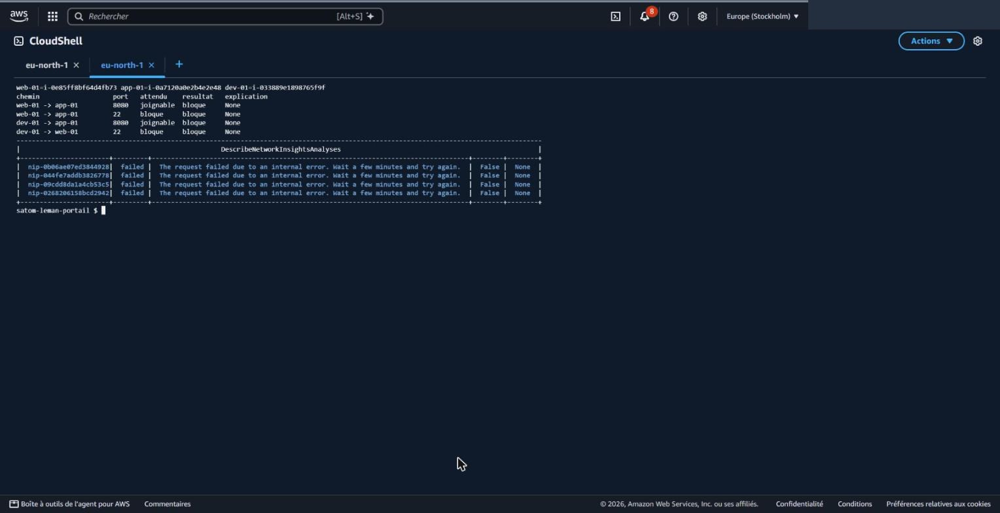

**Figure 41** · pull request #15 : sondes TCP réelles dans les instances de test (Reachability Analyzer indisponible)

**Figure 42** · état du compte : piles du portail stables, instances de test en marche, pare-feu du labo toujours présent

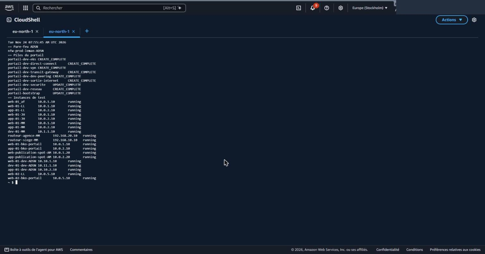

**Figure 43** · pull request #15 verte puis fusionnée

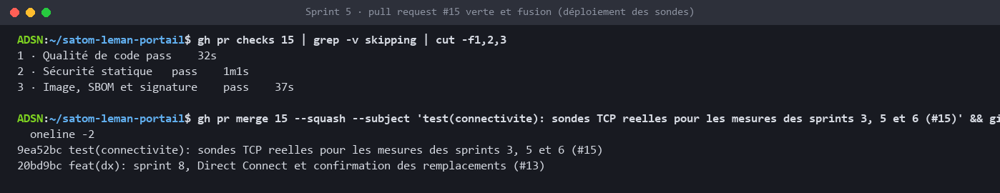

**Figure 44** · le script refuse la mise à jour des instances (remplacement conditionnel annoncé) sans confirmation

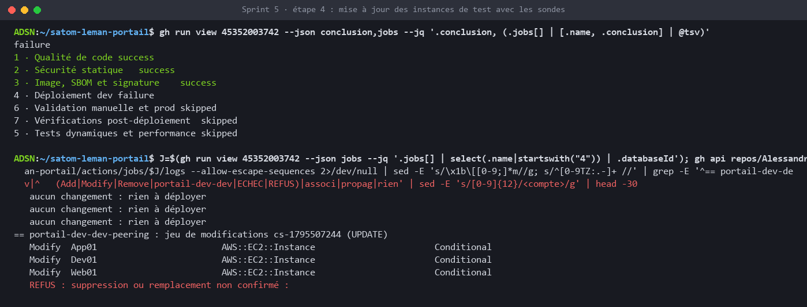

**Figure 45** · relance manuelle confirmée

**Figure 46** · instances mises à jour en 52 s, mêmes identifiants (redémarrage, pas de remplacement)

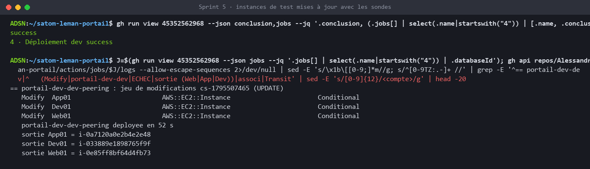

**Figure 47** · mesure par trafic réel : web-01→app-01 8080 OUVERT et 22 FERMÉ ; dev-01→app-01 8080 OUVERT par le peering, dev-01→web-01 22 FERMÉ

## Sprint 6 · Transit Gateway

**Figure 48** · pull request #14 : activation de la Transit Gateway et bascule du VPC dev (fusionnée après les mesures du sprint 5)

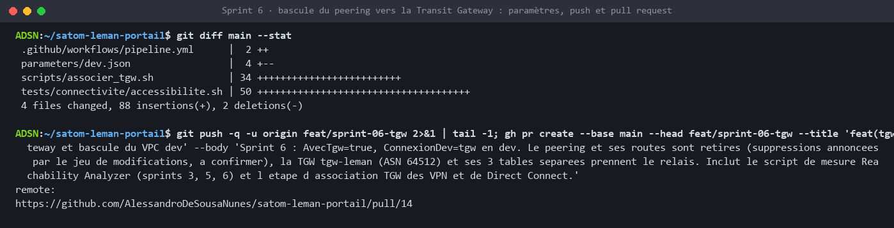

**Figure 49** · pull request #14 mise à jour avec main

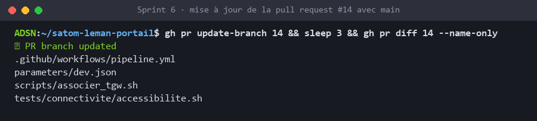

**Figure 50** · pull request #14 verte puis fusionnée

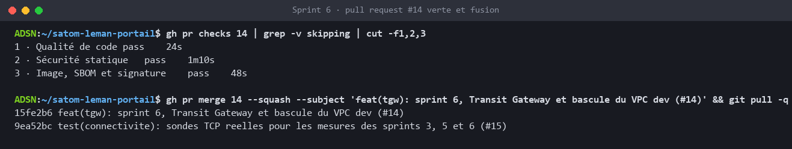

**Figure 51** · le jeu de modifications annonce la suppression du peering et de ses 3 routes : refusé sans confirmation

**Figure 52** · relance confirmée : peering retiré, TGW tgw-leman (ASN 64512), 2 attachements, 3 tables séparées, routes des VPC (187 s)

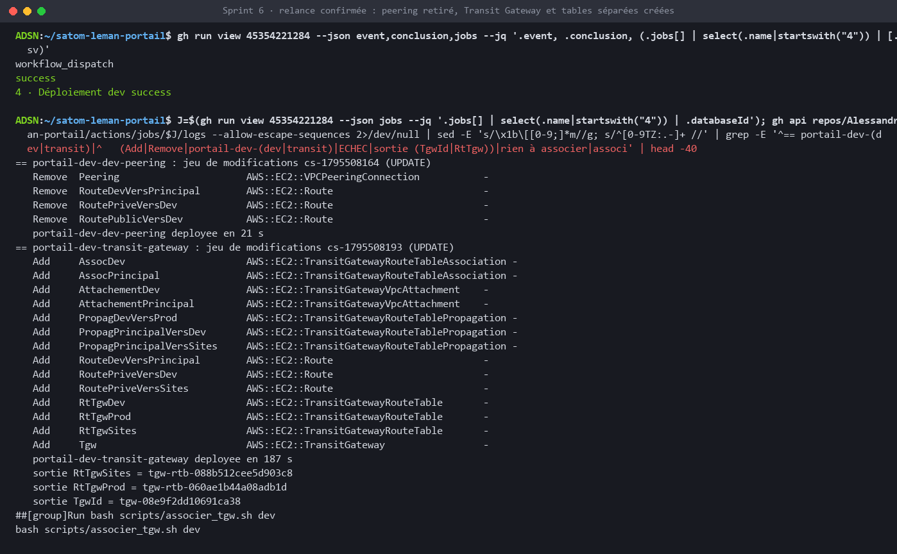

**Figure 53** · mesure dans CloudShell : rt-tgw-dev ne voit que le VPC principal, rt-tgw-prod voit dev, rt-tgw-sites voit le principal

**Figure 54** · workflow « mesures » à la demande (les captures de CloudShell se figeaient) : pull request #16 verte et fusionnée

**Figure 55** · état du déploiement dev lu par le rôle de la pipeline (lecture limitée aux piles portail-*)

**Figure 56** · trafic réel après la bascule : dev-01→app-01 8080 OUVERT par la TGW, dev-01→web-01 22 FERMÉ, web-01→app-01 8080 OUVERT et 22 FERMÉ

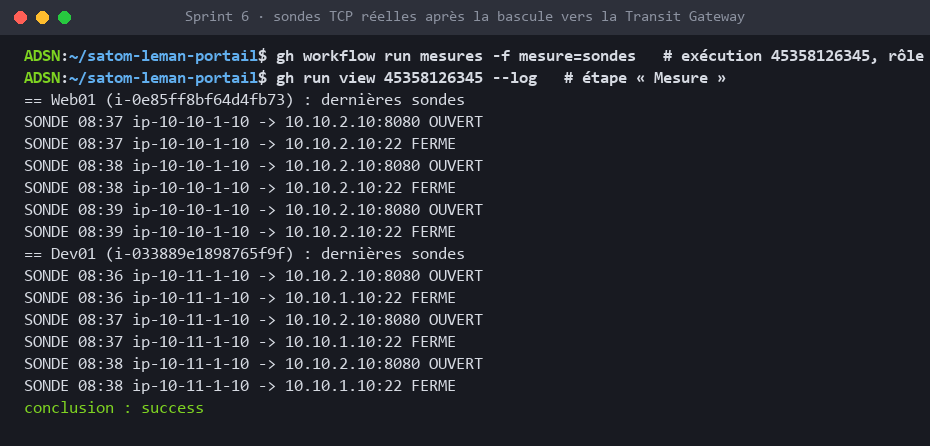

**Figure 57** · tables séparées vues par la pipeline : association et propagation par défaut désactivées

## Sprint 7 · VPN site à site

**Figure 58** · activation des VPN (AvecVpn=true) : commit et pull request #18

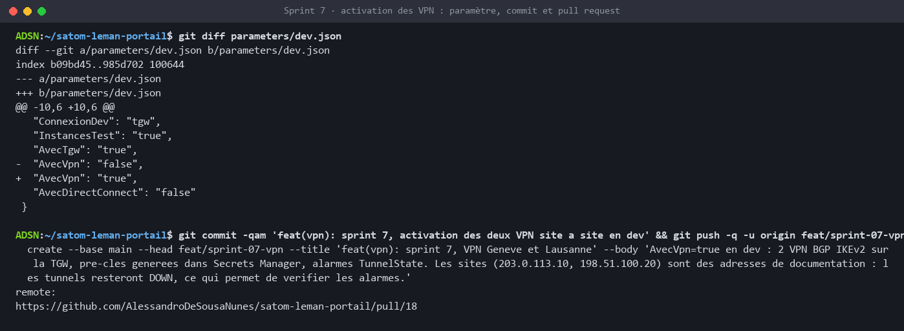

**Figure 59** · pull request #18 verte puis fusionnée

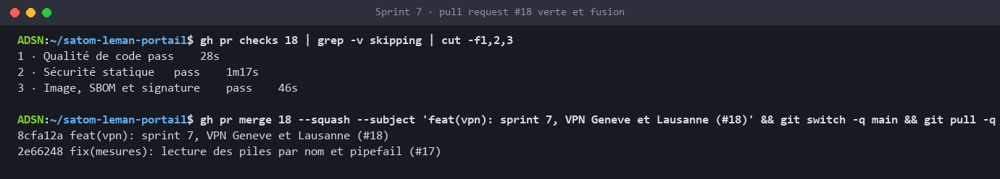

**Figure 60** · premier déploiement annulé : le rôle d'exécution n'a pas le droit de générer la pré-clé (secretsmanager:GetRandomPassword)

**Figure 61** · correction : droits Secrets Manager limités aux secrets portail/* (pull request #19)

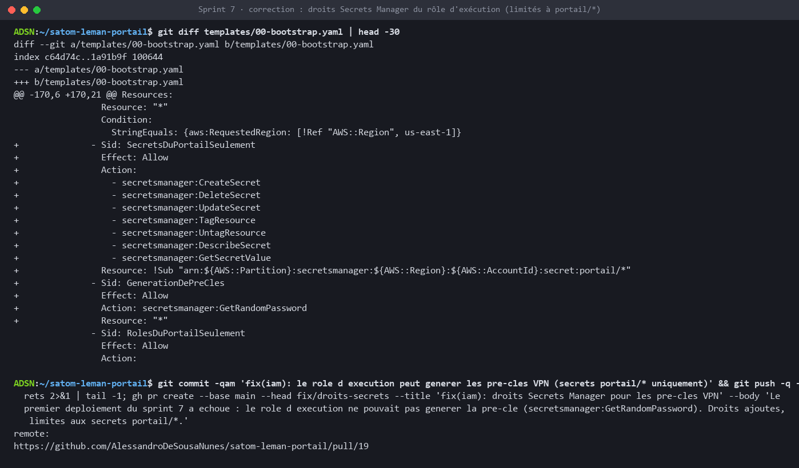

**Figure 62** · mise à jour de portail-bootstrap par scripts/maj_bootstrap.sh : 2 rôles modifiés sans remplacement

**Figure 63** · pull request #19 verte puis fusionnée

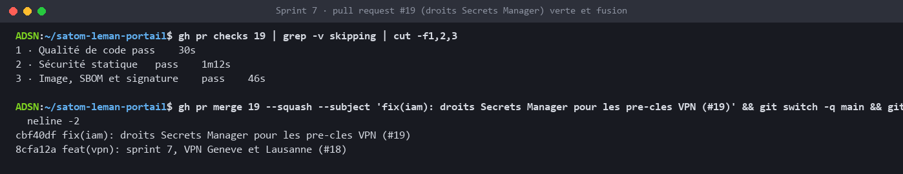

**Figure 64** · VPN, pré-clé et alarmes créés (263 s), attachements VPN rattachés à rt-tgw-sites et propagés dans rt-tgw-prod par la pipeline

**Figure 65** · mesure : BGP, IKEv2, AES-256, DH 20, tunnels DOWN (sites de documentation), pré-clé dans Secrets Manager, alarmes TunnelState en ALARM

## Sprint 8 · Direct Connect (conception)

**Figure 66** · branche, commit et pull request #13 : passerelle Direct Connect filtrée (ADR 0004), option de confirmation des remplacements

**Figure 67** · jeu de modifications de portail-bootstrap : 2 rôles modifiés, aucun remplacement

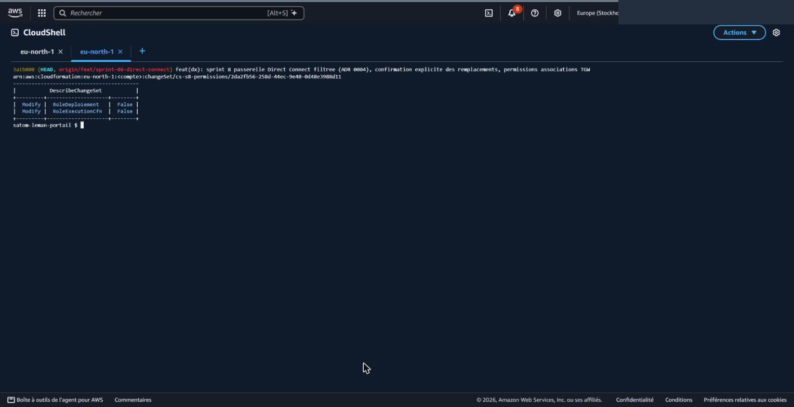

**Figure 68** · portail-bootstrap UPDATE_COMPLETE : le rôle d'exécution peut créer la passerelle Direct Connect

**Figure 69** · pull request #13 verte puis fusionnée

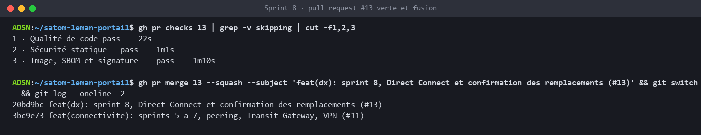

**Figure 70** · activation de la passerelle Direct Connect en dev : commit et pull request #22

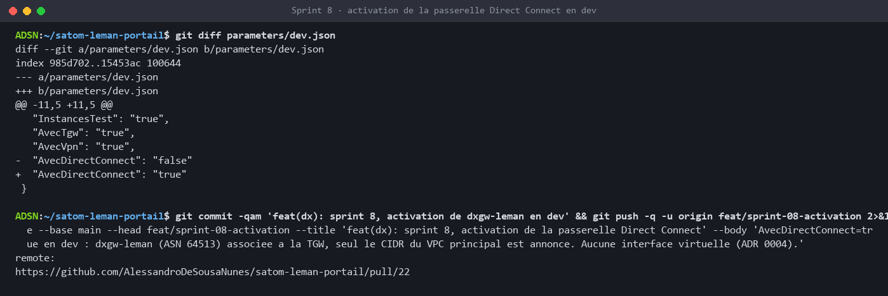

**Figure 71** · pull request #22 verte puis fusionnée

**Figure 72** · passerelle dxgw-leman et association filtrée créées (252 s), attachement Direct Connect rattaché à rt-tgw-sites, VPN déjà rattachés ignorés (script idempotent)

**Figure 73** · mesure : dxgw-leman ASN 64513, seul 10.10.0.0/16 annoncé, 0 interface virtuelle ; la TGW porte 2 VPC, 2 VPN et Direct Connect dans les bonnes tables

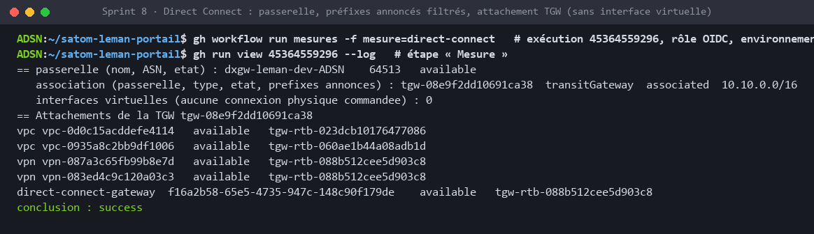

**Figure 74** · option de démontage en ordre inverse et désactivation de TGW, VPN et Direct Connect (pull request #23)

**Figure 75** · fusion de la pull request #23 et démontage lancé (ordre inverse, suppressions confirmées)

**Figure 76** · Direct Connect (137 s), VPN (147 s) puis TGW (158 s) supprimés dans l'ordre inverse : plus aucune ressource réseau facturée à l'heure

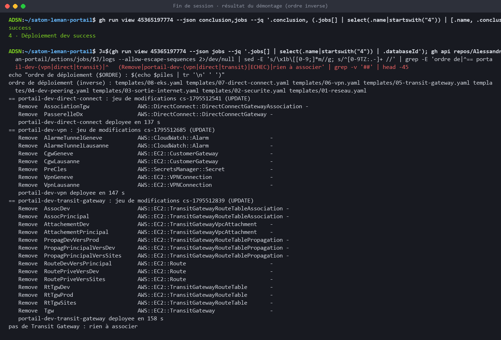

## Sprint 9 · Kubernetes (EKS) et ALB

**Figure 77** · pull request #24 : EKS, ECR privé, contrôleur ALB, certificat, application au digest ; vérifications vertes et fusion

**Figure 78** · lancement confirmé du déploiement (suppression des instances de test, clé KMS modifiée)

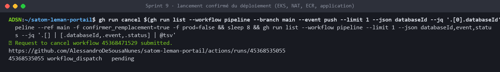

**Figure 79** · premier déploiement refusé faute de ecr:CreateRepository ; mise à jour de portail-bootstrap (ECR, ACM, us-east-1, Route 53) sans remplacement

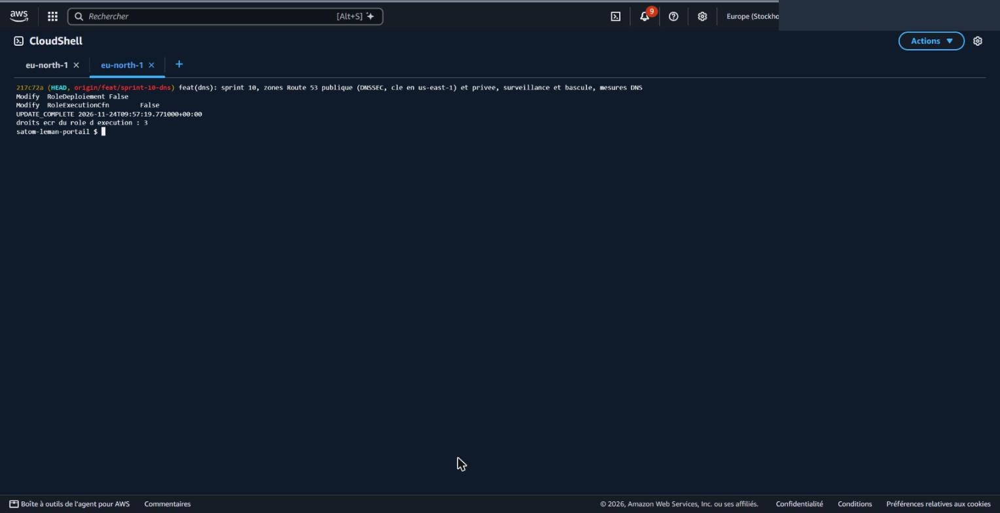

**Figure 80** · premier déploiement : NAT créée, instances de test supprimées, cluster annulé car le rôle d'exécution n'avait pas ecr:CreateRepository

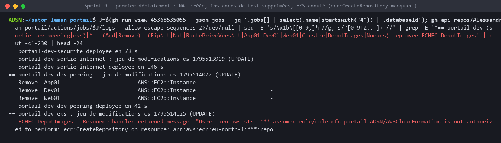

**Figure 81** · exécution de la pipeline vue dans GitHub Actions (connecté) : étapes 1 à 3 vertes, déploiement dev en cours, « No leaks detected »

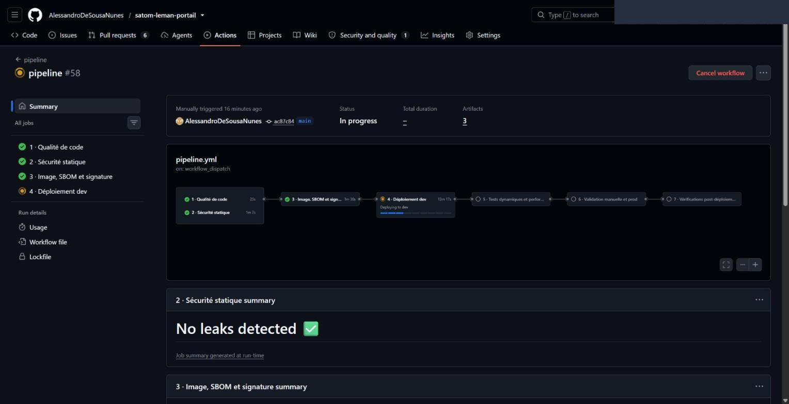

**Figure 82** · deuxième échec (groupe de nœuds : iam:ListAttachedRolePolicies manquant) ; mise à jour des rôles sans remplacement

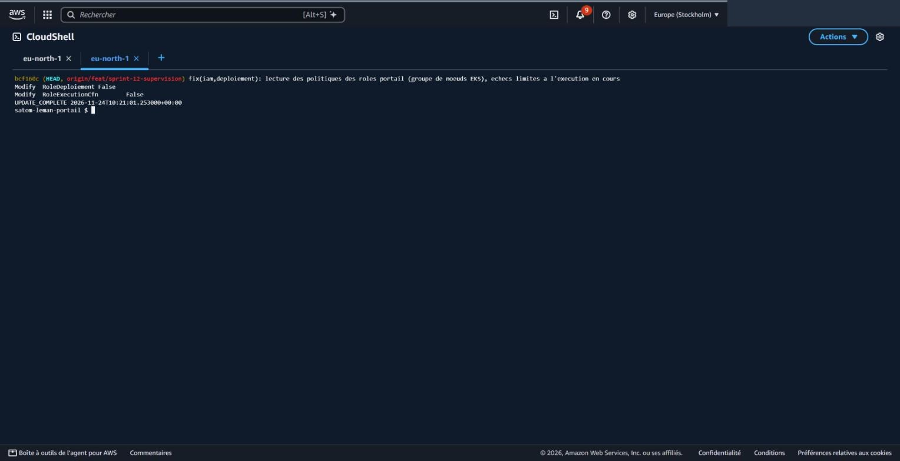

**Figure 83** · déploiement complet dev lancé (étapes 1 et 2 en cours)

**Figure 84** · le déploiement s'arrête : une SCP de l'organisation interdit us-east-1 au rôle de la pipeline (explicit deny)

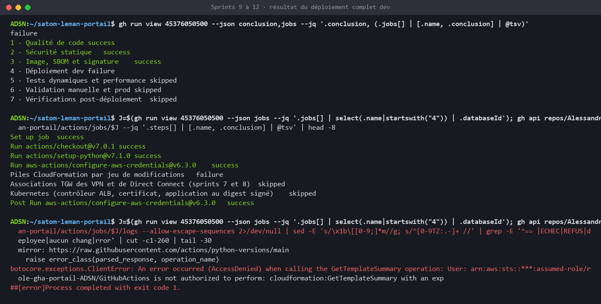

**Figure 85** · Vérification de la SCP : eu-central-2 (région du TP) interdite au compte ; us-east-1 accessible au rôle console mais pas au rôle de la pipeline

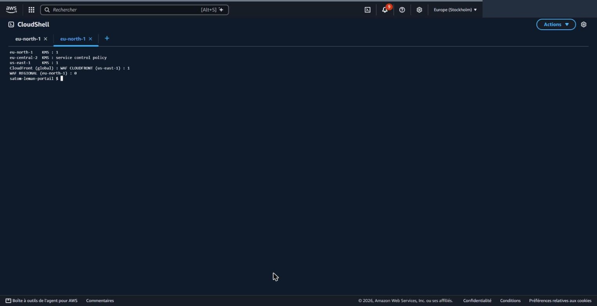

**Figure 86** · relance du déploiement complet de dev par workflow_dispatch

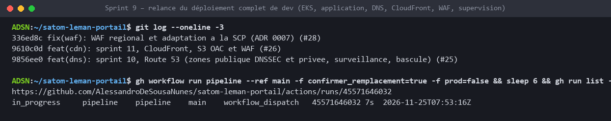

## Sprint 10 · Route 53

**Figure 87** · pull request #25 (Route 53, DNSSEC, bascule) verte puis fusionnée

**Figure 88** · pull requests empilées : #25 (dns) et #26 (cdn) fusionnées dans main, #27 (supervision) intégrée à la branche du sprint 11

**Figure 89** · historique de main après résolution du conflit dû aux fusions squash

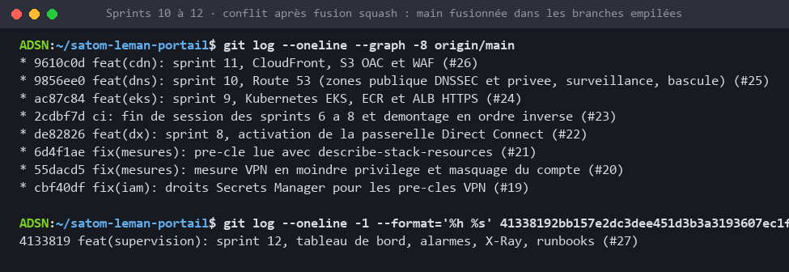

## Sprint 11 · CloudFront et WAF

**Figure 90** · la sécurité bloque la PR #26 : écriture IAM sans restriction (CKV_AWS_111) ; correctif : droits limités aux ressources du compte

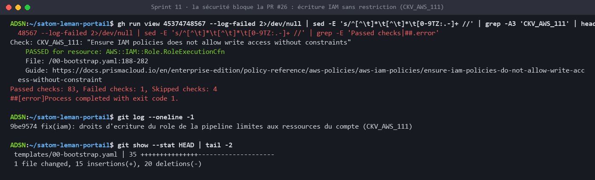

**Figure 91** · pull request #26 verte après correction puis fusionnée (le sprint 12 y avait été intégré)

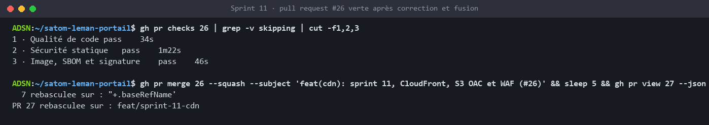

**Figure 92** · portail-bootstrap aligné sur main, rôle de la pipeline resserré sans remplacement

**Figure 93** · adaptation à la SCP : WAF régional sur l'ALB, retrait d'us-east-1, ADR 0007 ; commit et pull request #28

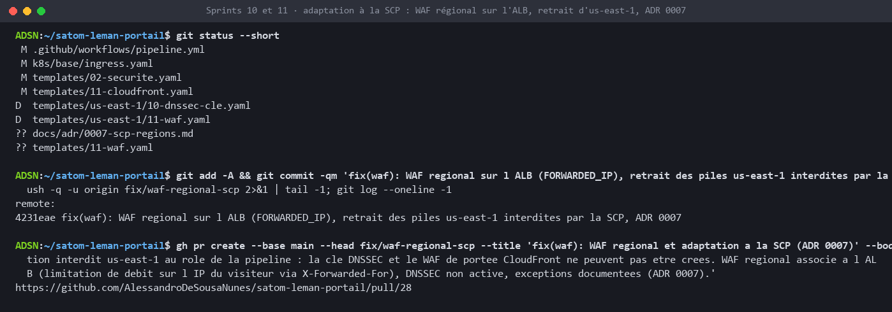

**Figure 94** · pull request #28 verte, fusion, relance confirmée du déploiement complet

## Documentation · journal, ADR, indicateurs DORA

**Figure 95** · journal du 24.11 (incidents, gouvernance, DORA) et ADR 0006 (sprint 4 reporté pour incident AWS)

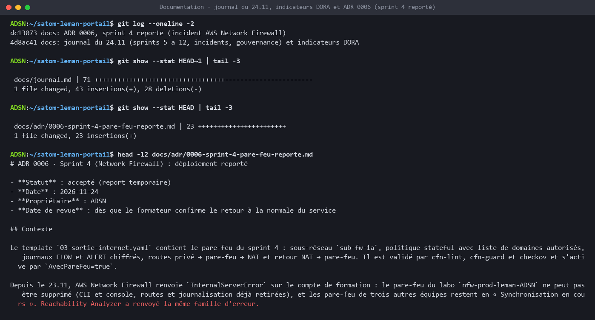

**Figure 96** · pull request #29 : journal du 24.11, DORA, ADR 0006

