# Captures du TP final

Chaque étape est réalisée en ligne de commande (poste, GitHub CLI, CloudShell) ou par la pipeline.
Le numéro de compte AWS est masqué sur toutes les captures.

## Gate G0 · socle du projet (dépôt, pipeline, OIDC)

**Figure 1** · arborescence du dépôt : templates, parameters, policies, app, k8s, tests, scripts, sbom, docs, .github/workflows

**Figure 2** · 18 tests unitaires verts, couverture 97,9 % (seuil 80 %)

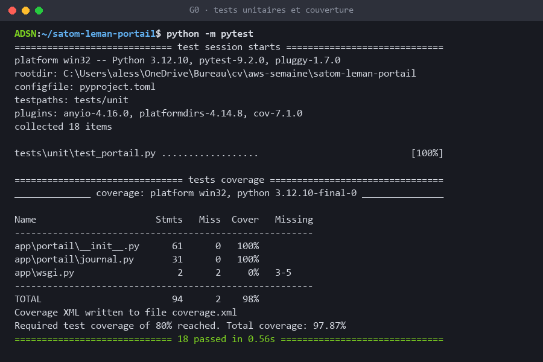

**Figure 3** · qualité : ruff (lint et format) et cfn-lint sans erreur

**Figure 4** · sécurité statique en local : checkov 285 contrôles réussis (CloudFormation, Kubernetes, Dockerfile), aucun chevauchement de CIDR

**Figure 5** · création du dépôt public AlessandroDeSousaNunes/satom-leman-portail avec gh et premier commit

**Figure 6** · protection de main : ruleset (pull request, historique linéaire, 3 vérifications obligatoires), secret scanning et push protection, alertes Dependabot

**Figure 7** · environnements dev et prod, prod soumis à la validation manuelle d'AlessandroDeSousaNunes

**Figure 8** · branche feat/g0-socle, 5 commits au format Conventional Commits, push

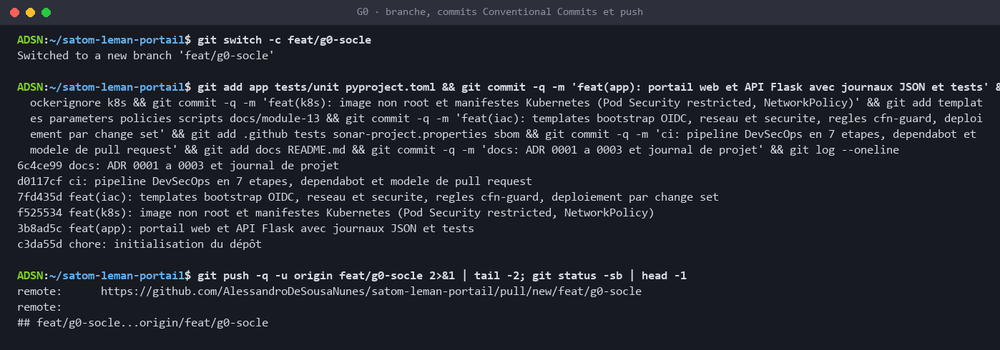

**Figure 9** · première exécution : qualité verte, sécurité en échec (version de l'action Trivy introuvable), étapes suivantes bloquées

**Figure 10** · correction : versions publiées des actions GitHub, commit fix(ci)

**Figure 11** · SCA : pip-audit bloque la pipeline sur Flask 3.1.2 (PYSEC-2026-2151), passage en 3.1.3, plus aucune vulnérabilité

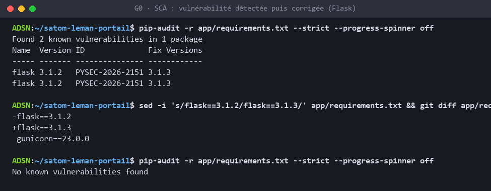

**Figure 12** · pull request #1 : étapes 1 à 3 vertes (qualité, sécurité statique, image + SBOM), 3 artefacts ; étapes 4 à 7 réservées à main

**Figure 13** · vérifications de la pull request #1 au vert puis fusion squash dans main

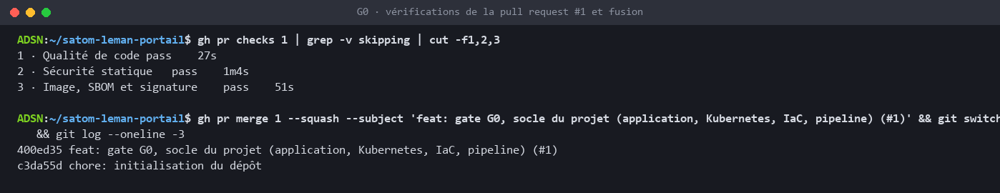

**Figure 14** · exécution sur main après fusion : étapes 1 à 3 vertes, étapes AWS en attente de la variable AWS_DEPLOIEMENT

**Figure 15** · image publiée sur ghcr.io, signature cosign vérifiée (journal de transparence), SBOM CycloneDX de 2784 composants

**Figure 16** · jeu de modifications de la pile portail-bootstrap : 2 rôles IAM ajoutés (fournisseur OIDC GitHub existant réutilisé)

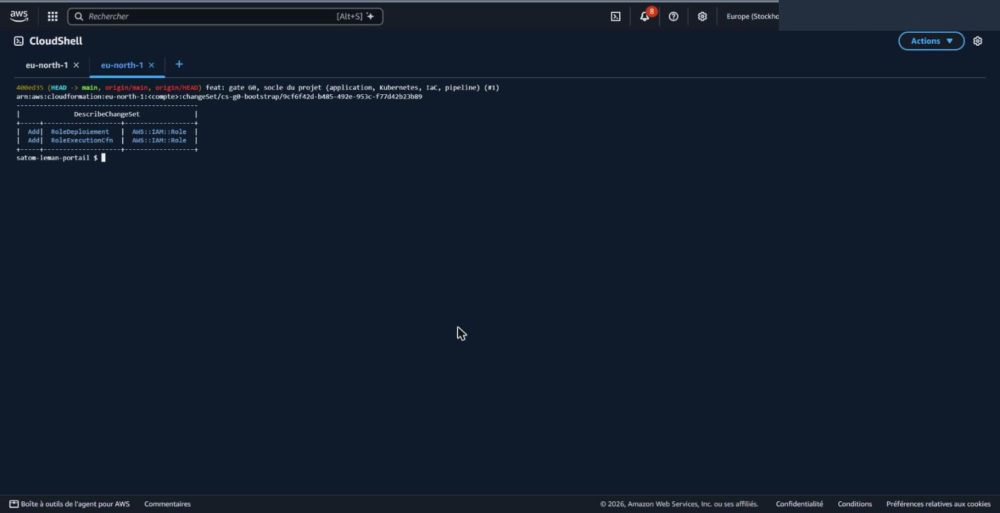

**Figure 17** · portail-bootstrap CREATE_COMPLETE : role-gha-portail-ADSN limité au dépôt (main, environnements dev et prod) et role-cfn-portail-ADSN

**Figure 18** · diagnostic : fournisseur OIDC GitHub du compte correct (audience sts.amazonaws.com)

**Figure 19** · correction : le rôle accepte le claim sub avec identifiants immuables (propriétaire@260914278, dépôt@1468484199), mise à jour sans remplacement

**Figure 20** · SonarQube Cloud : organisation alessandrodesousanunes importée depuis GitHub

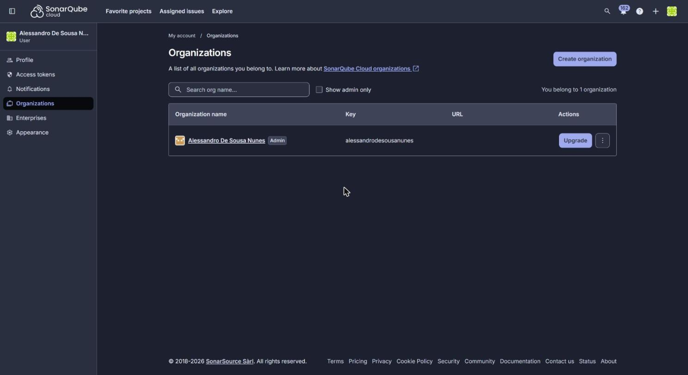

**Figure 21** · SonarQube Cloud : import du dépôt public satom-leman-portail

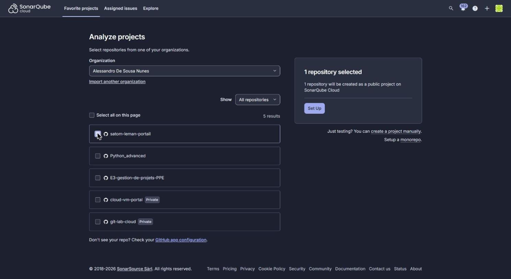

**Figure 22** · SonarQube Cloud : projet créé, première analyse

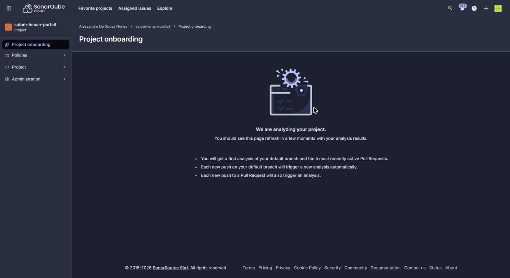

**Figure 23** · SonarQube Cloud : analyse automatique désactivée, l'analyse (avec couverture) est faite par GitHub Actions

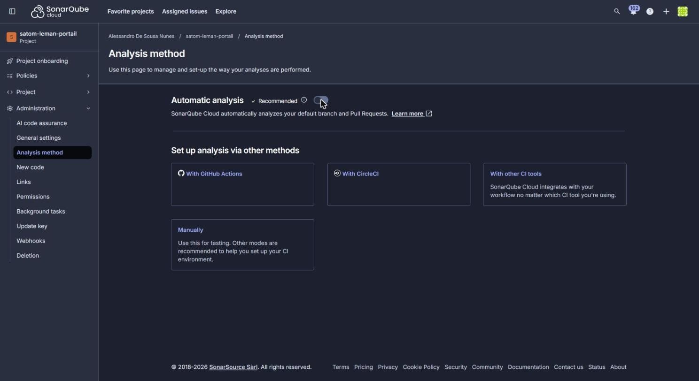

**Figure 24** · SonarQube Cloud : génération du token d'analyse (30 jours), par l'étudiant

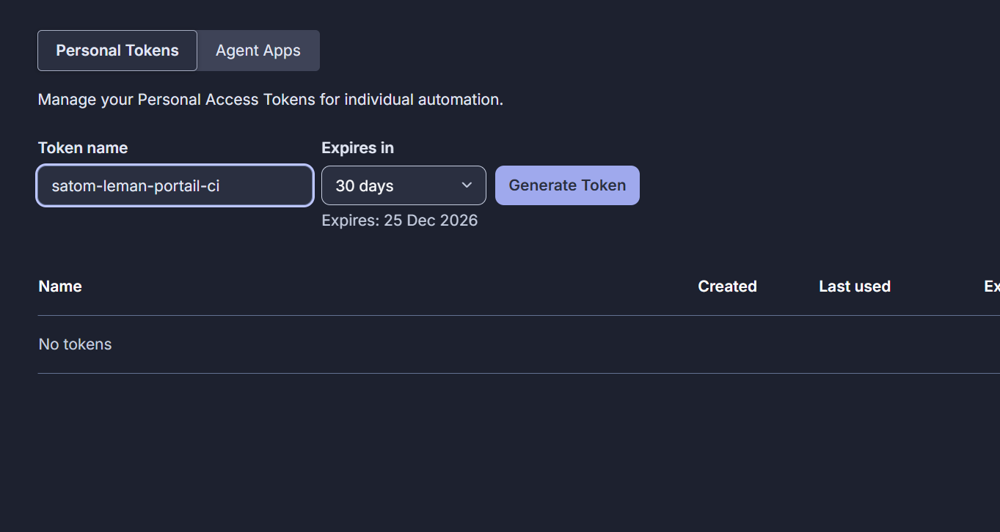

**Figure 25** · token enregistré comme secret GitHub SONAR_TOKEN (valeur masquée, jamais versionnée)

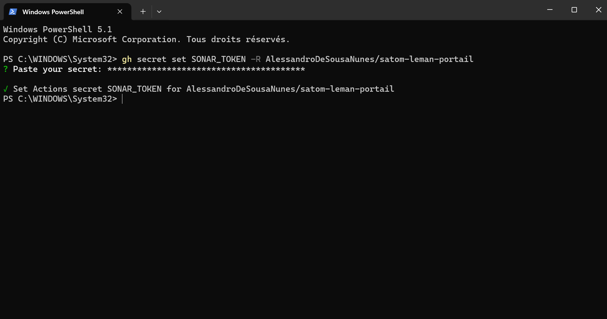

**Figure 26** · secrets et variables en place, relance de l'étape qualité avec SonarQube Cloud

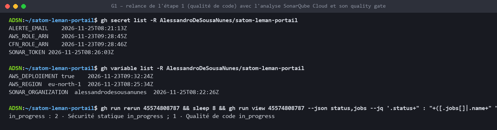

**Figure 27** · première analyse de la PR #33 : quality gate échoué, note de sécurité C (6 problèmes)

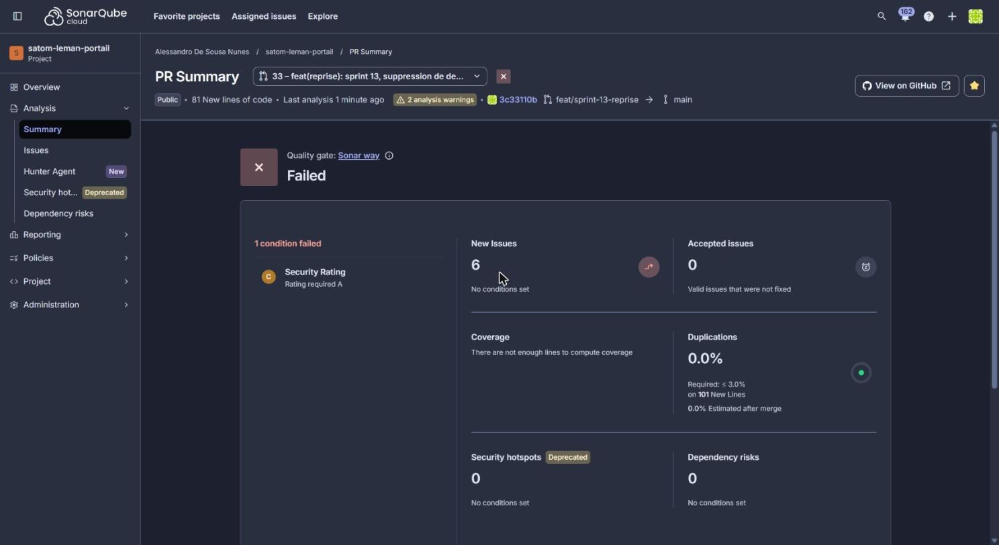

**Figure 28** · les 6 problèmes listés par l'API SonarQube et leur correction

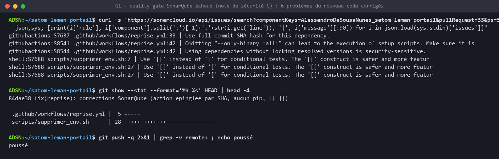

**Figure 29** · SonarQube Cloud : quality gate Sonar way PASSED sur la PR #33 (0 problème, 0 % de duplication)

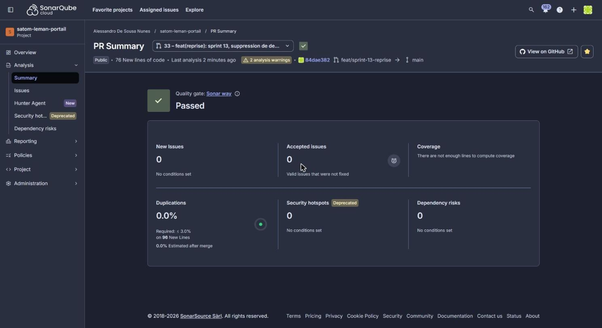

## Nettoyage du labo de la semaine (avant le TP final)

**Figure 30** · inventaire avant : ressources ADSN encore actives depuis vendredi (NAT, TGW, VPN, pare-feu, 2 ALB, instances, zones, CloudFront)

**Figure 31** · essai à blanc : uniquement des ressources étiquetées Equipe=ADSN, aucune ressource d'une autre équipe

**Figure 32** · journal du script : suppression dans l'ordre des dépendances

**Figure 33** · inventaire après : toutes les ressources ADSN supprimées sauf le pare-feu (erreur interne AWS, nouvelle tentative toutes les 2 minutes), budget conservé

**Figure 34** · les 4 pare-feu du compte (ADSN et 3 autres équipes) restent bloqués en « Synchronisation en cours »

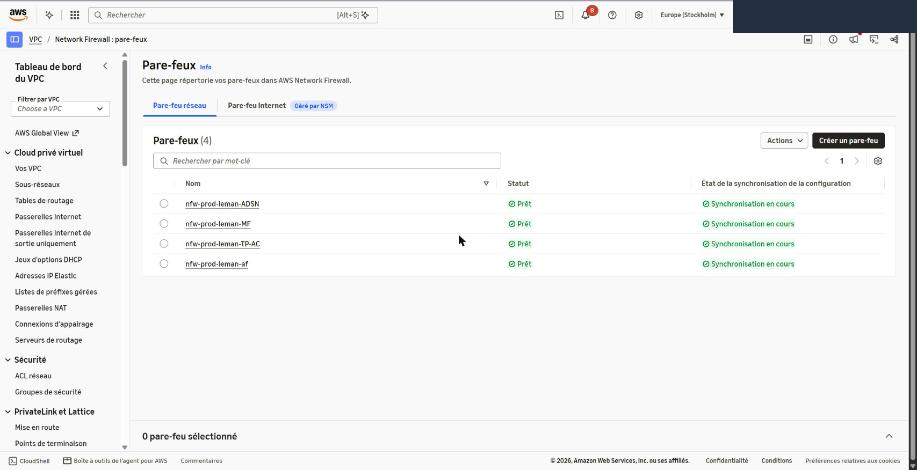

**Figure 35** · suppression de nfw-prod-leman-ADSN par la console : « Internal failure », même erreur qu'en ligne de commande (incident côté AWS)

**Figure 36** · 24.11 : le pare-feu est READY et IN_SYNC, la suppression renvoie toujours « Internal failure »

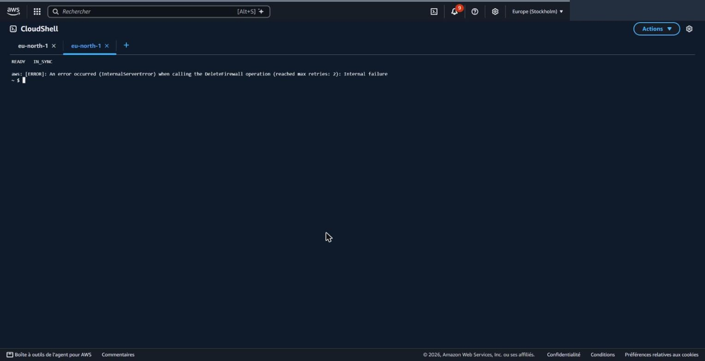

## Sprints 1 à 3 · VPC, routage, Security Groups et NACL

**Figure 37** · pull request #8 verte, activation du déploiement AWS (AWS_DEPLOIEMENT=true) et fusion

**Figure 38** · étape 4 de la pipeline : piles dev créées par jeux de modifications (réseau, sécurité, sortie Internet), étape 6 en attente de validation

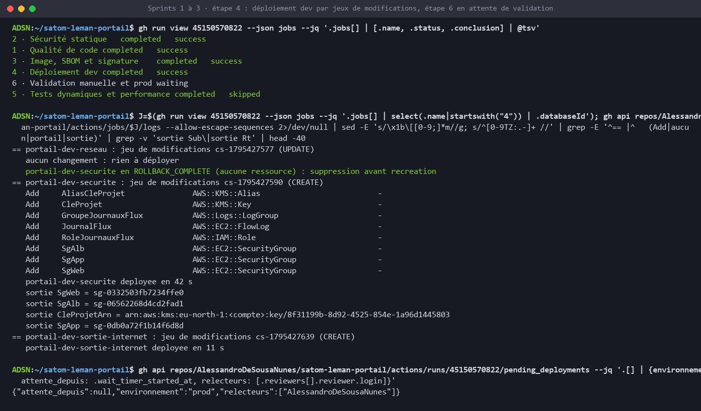

**Figure 39** · étape 6 : mise en prod refusée par le relecteur, reportée au sprint 13 (la porte d'approbation fonctionne)

**Figure 40** · mesure : describe-subnets sur vpc-portail-dev-ADSN, sous-réseaux publics et privés sur deux zones, sub-public-1b en 10.10.5.0/24, aucune IP publique automatique

**Figure 41** · mesure : table privée sans route vers l'IGW, groupes de sécurité (SSH seulement depuis la salle, 8080 seulement depuis sg-web), NACL

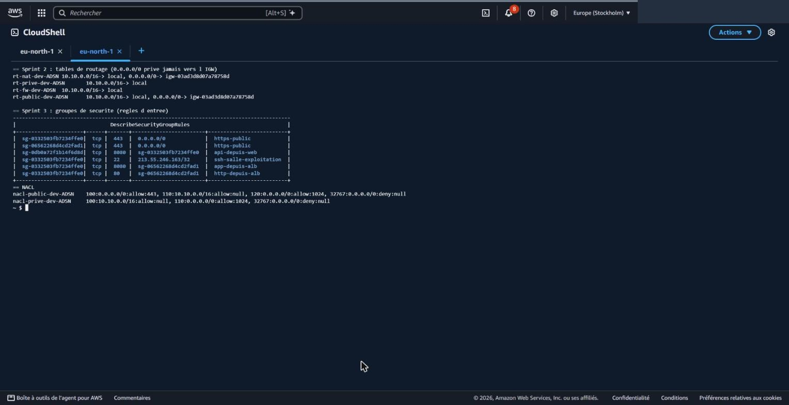

## Sprints 5 à 7 (socle commun) puis sprint 5 · peering VPC

**Figure 42** · pull request #11 mise à jour avec main, fichiers modifiés (templates 04 à 06, paramètres, bootstrap)

**Figure 43** · la protection de main refuse la fusion : l'étape 2 (sécurité) est en échec

**Figure 44** · cause : la règle cfn-guard exigeait des règles d'entrée même sur dev-sg, qui n'en a volontairement aucune

**Figure 45** · correction : la règle ne vérifie que les groupes ayant des règles d'entrée

**Figure 46** · pull request #11 verte puis fusionnée

**Figure 47** · étape 4 : le script de déploiement refuse un remplacement non confirmé (journal de flux, Replacement=Conditional)

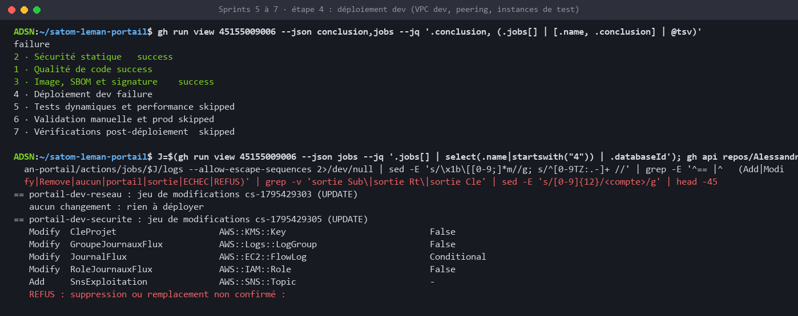

**Figure 48** · exécution automatique annulée, relance manuelle avec confirmation du remplacement relu (journal de flux)

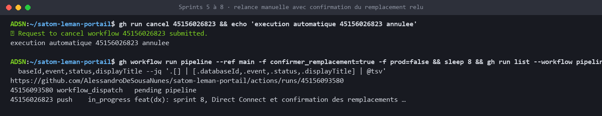

**Figure 49** · étape 4 avec confirmation : journal de flux remplacé, sujet SNS ajouté, VPC dev, peering pcx-0267… et instances web-01, app-01, dev-01 créés en 42 s

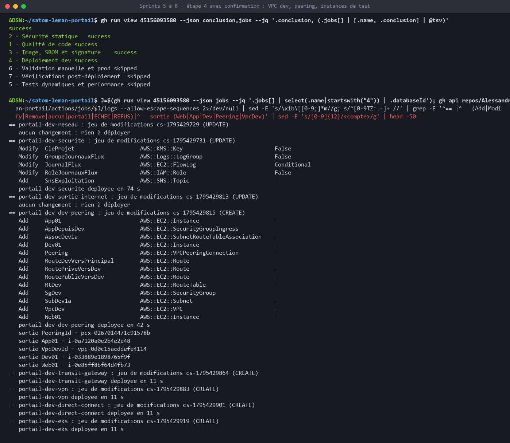

**Figure 50** · première mesure Reachability Analyzer : les 4 analyses échouent côté AWS (internal error) ; le script les comptait à tort comme « bloqué », il est corrigé pour signaler ECHEC

**Figure 51** · pull request #15 : sondes TCP réelles dans les instances de test (Reachability Analyzer indisponible)

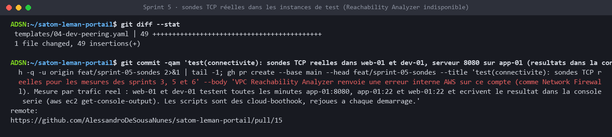

**Figure 52** · état du compte : piles du portail stables, instances de test en marche, pare-feu du labo toujours présent

**Figure 53** · pull request #15 verte puis fusionnée

**Figure 54** · le script refuse la mise à jour des instances (remplacement conditionnel annoncé) sans confirmation

**Figure 55** · relance manuelle confirmée

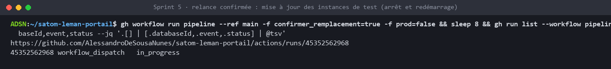

**Figure 56** · instances mises à jour en 52 s, mêmes identifiants (redémarrage, pas de remplacement)

**Figure 57** · mesure par trafic réel : web-01→app-01 8080 OUVERT et 22 FERMÉ ; dev-01→app-01 8080 OUVERT par le peering, dev-01→web-01 22 FERMÉ

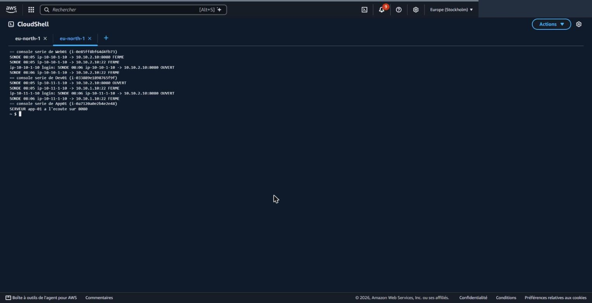

## Sprint 6 · Transit Gateway

**Figure 58** · pull request #14 : activation de la Transit Gateway et bascule du VPC dev (fusionnée après les mesures du sprint 5)

**Figure 59** · pull request #14 mise à jour avec main

**Figure 60** · pull request #14 verte puis fusionnée

**Figure 61** · le jeu de modifications annonce la suppression du peering et de ses 3 routes : refusé sans confirmation

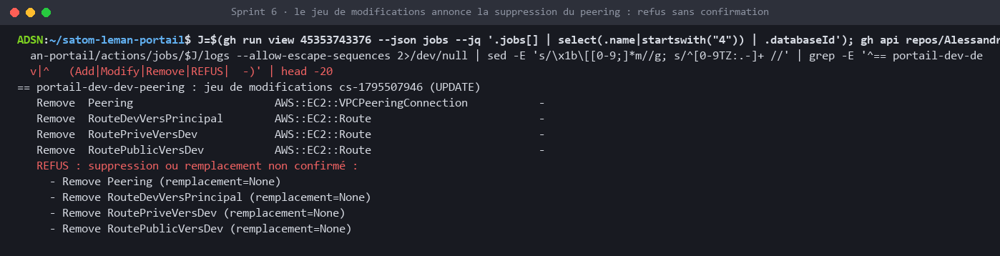

**Figure 62** · relance confirmée : peering retiré, TGW tgw-leman (ASN 64512), 2 attachements, 3 tables séparées, routes des VPC (187 s)

**Figure 63** · mesure dans CloudShell : rt-tgw-dev ne voit que le VPC principal, rt-tgw-prod voit dev, rt-tgw-sites voit le principal

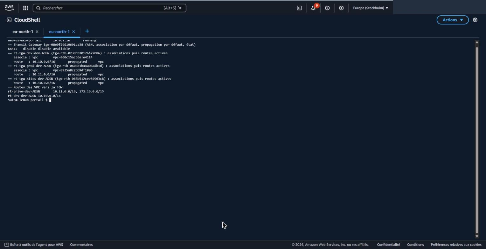

**Figure 64** · workflow « mesures » à la demande (les captures de CloudShell se figeaient) : pull request #16 verte et fusionnée

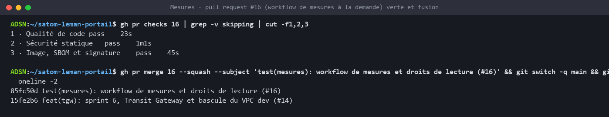

**Figure 65** · état du déploiement dev lu par le rôle de la pipeline (lecture limitée aux piles portail-*)

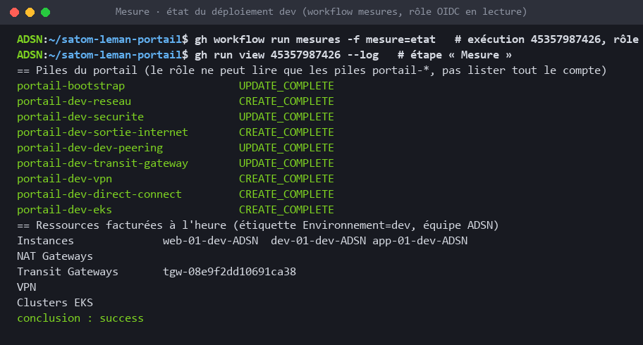

**Figure 66** · trafic réel après la bascule : dev-01→app-01 8080 OUVERT par la TGW, dev-01→web-01 22 FERMÉ, web-01→app-01 8080 OUVERT et 22 FERMÉ

**Figure 67** · tables séparées vues par la pipeline : association et propagation par défaut désactivées

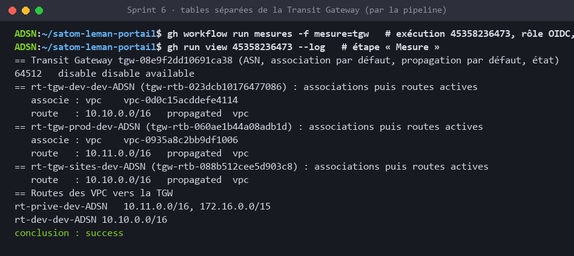

## Sprint 7 · VPN site à site

**Figure 68** · activation des VPN (AvecVpn=true) : commit et pull request #18

**Figure 69** · pull request #18 verte puis fusionnée

**Figure 70** · premier déploiement annulé : le rôle d'exécution n'a pas le droit de générer la pré-clé (secretsmanager:GetRandomPassword)

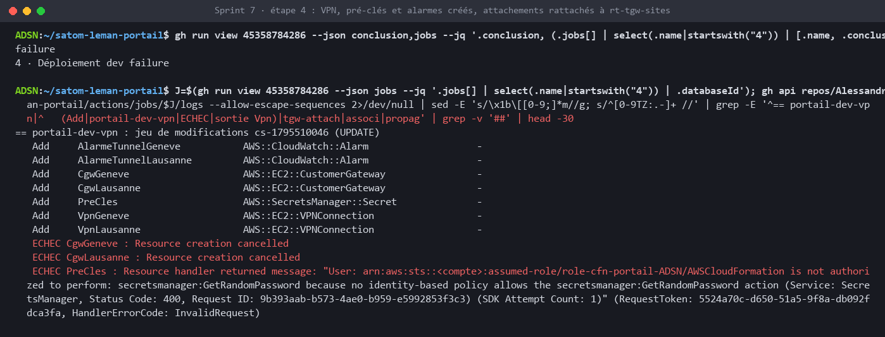

**Figure 71** · correction : droits Secrets Manager limités aux secrets portail/* (pull request #19)

**Figure 72** · mise à jour de portail-bootstrap par scripts/maj_bootstrap.sh : 2 rôles modifiés sans remplacement

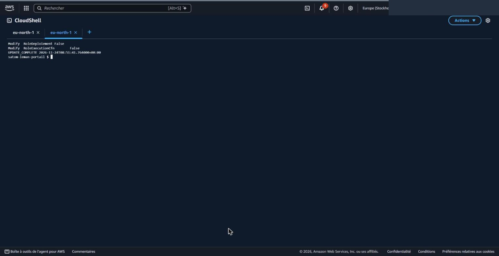

**Figure 73** · pull request #19 verte puis fusionnée

**Figure 74** · VPN, pré-clé et alarmes créés (263 s), attachements VPN rattachés à rt-tgw-sites et propagés dans rt-tgw-prod par la pipeline

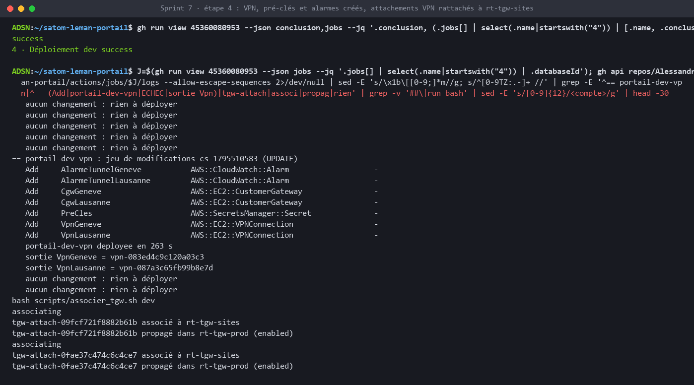

**Figure 75** · mesure : BGP, IKEv2, AES-256, DH 20, tunnels DOWN (sites de documentation), pré-clé dans Secrets Manager, alarmes TunnelState en ALARM

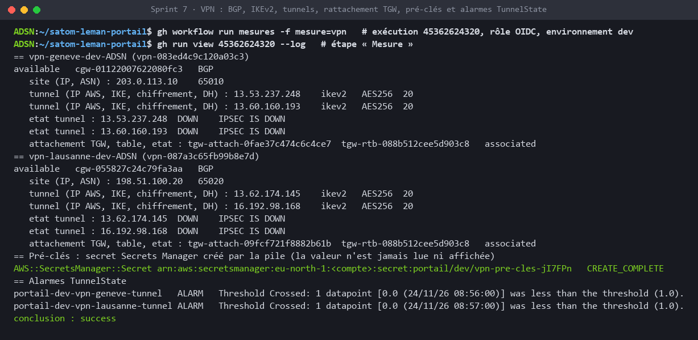

## Sprint 8 · Direct Connect (conception)

**Figure 76** · branche, commit et pull request #13 : passerelle Direct Connect filtrée (ADR 0004), option de confirmation des remplacements

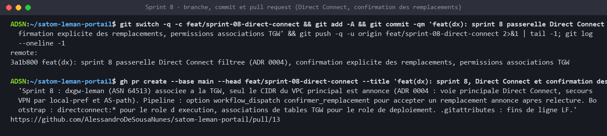

**Figure 77** · jeu de modifications de portail-bootstrap : 2 rôles modifiés, aucun remplacement

**Figure 78** · portail-bootstrap UPDATE_COMPLETE : le rôle d'exécution peut créer la passerelle Direct Connect

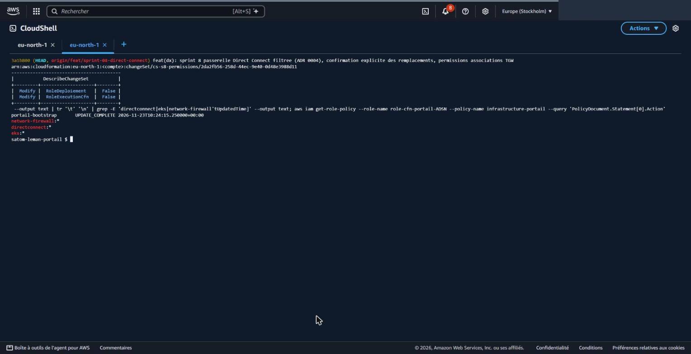

**Figure 79** · pull request #13 verte puis fusionnée

**Figure 80** · activation de la passerelle Direct Connect en dev : commit et pull request #22

**Figure 81** · pull request #22 verte puis fusionnée

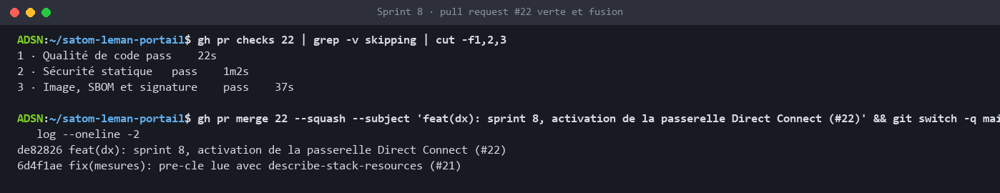

**Figure 82** · passerelle dxgw-leman et association filtrée créées (252 s), attachement Direct Connect rattaché à rt-tgw-sites, VPN déjà rattachés ignorés (script idempotent)

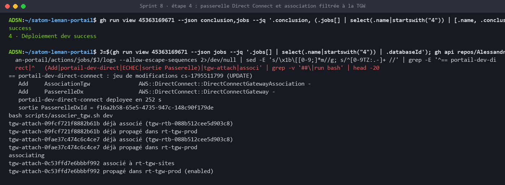

**Figure 83** · mesure : dxgw-leman ASN 64513, seul 10.10.0.0/16 annoncé, 0 interface virtuelle ; la TGW porte 2 VPC, 2 VPN et Direct Connect dans les bonnes tables

**Figure 84** · option de démontage en ordre inverse et désactivation de TGW, VPN et Direct Connect (pull request #23)

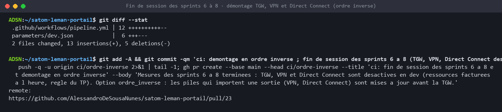

**Figure 85** · fusion de la pull request #23 et démontage lancé (ordre inverse, suppressions confirmées)

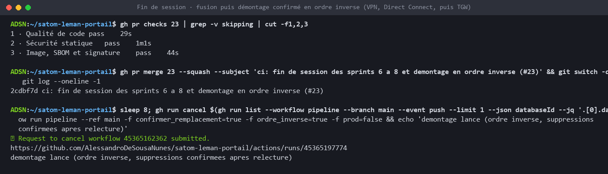

**Figure 86** · Direct Connect (137 s), VPN (147 s) puis TGW (158 s) supprimés dans l'ordre inverse : plus aucune ressource réseau facturée à l'heure

## Sprint 9 · Kubernetes (EKS) et ALB

**Figure 87** · pull request #24 : EKS, ECR privé, contrôleur ALB, certificat, application au digest ; vérifications vertes et fusion

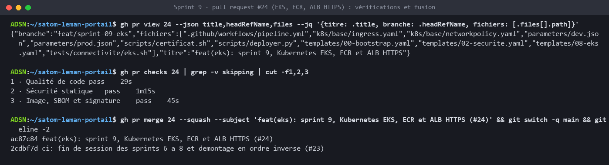

**Figure 88** · lancement confirmé du déploiement (suppression des instances de test, clé KMS modifiée)

**Figure 89** · premier déploiement refusé faute de ecr:CreateRepository ; mise à jour de portail-bootstrap (ECR, ACM, us-east-1, Route 53) sans remplacement

**Figure 90** · premier déploiement : NAT créée, instances de test supprimées, cluster annulé car le rôle d'exécution n'avait pas ecr:CreateRepository

**Figure 91** · exécution de la pipeline vue dans GitHub Actions (connecté) : étapes 1 à 3 vertes, déploiement dev en cours, « No leaks detected »

**Figure 92** · deuxième échec (groupe de nœuds : iam:ListAttachedRolePolicies manquant) ; mise à jour des rôles sans remplacement

**Figure 93** · déploiement complet dev lancé (étapes 1 et 2 en cours)

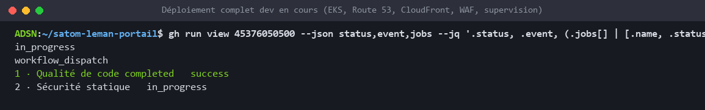

**Figure 94** · le déploiement s'arrête : une SCP de l'organisation interdit us-east-1 au rôle de la pipeline (explicit deny)

**Figure 95** · Vérification de la SCP : eu-central-2 (région du TP) interdite au compte ; us-east-1 accessible au rôle console mais pas au rôle de la pipeline

**Figure 96** · relance du déploiement complet de dev par workflow_dispatch

**Figure 97** · pipeline #69 : étapes 1 à 3 vertes (aucune fuite, image signée), déploiement de dev en cours

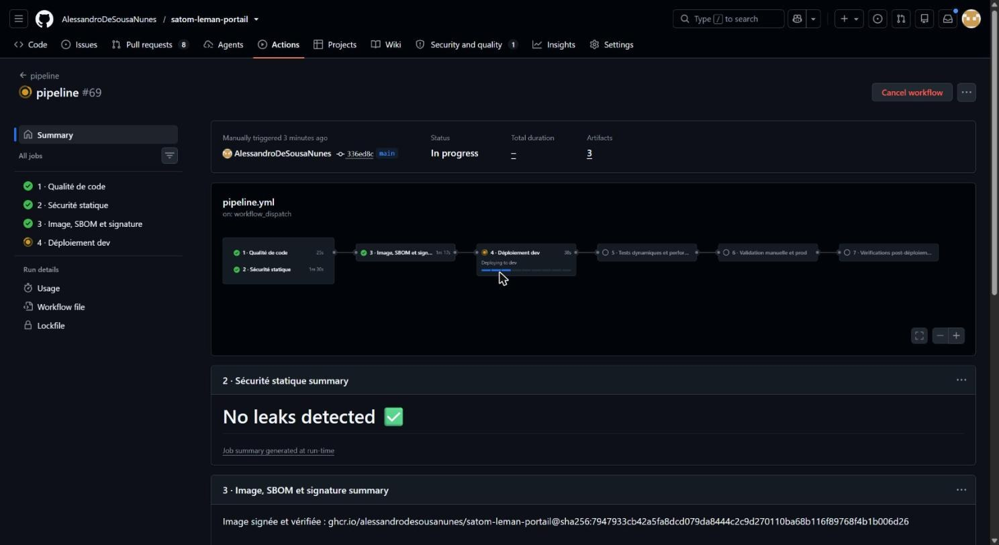

**Figure 98** · CloudShell : la pile portail-dev-securite revient en arrière pendant le déploiement

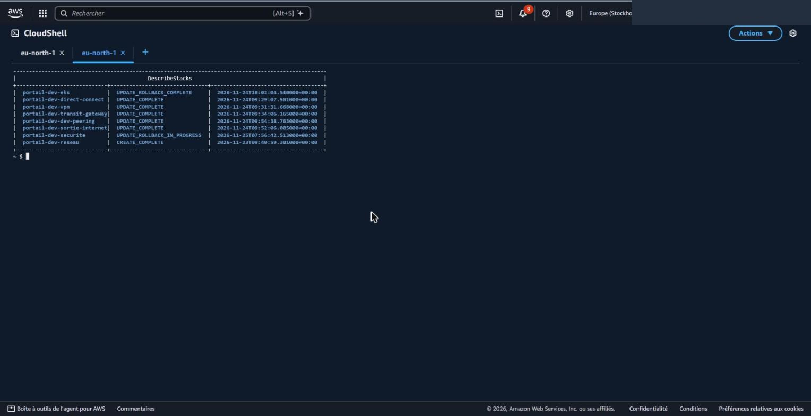

**Figure 99** · cause : « maximum number of rules per security group » ; la liste de préfixes CloudFront (~55 entrées) est référencée deux fois (80 et 443), limite 60

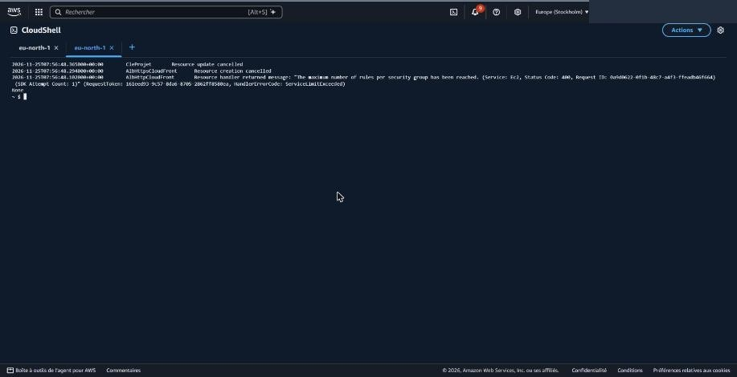

**Figure 100** · mesure dans CloudShell : la liste CloudFront compte 52 entrées, quota de 60 règles par groupe ; deux références = 104 règles, une seule = 53

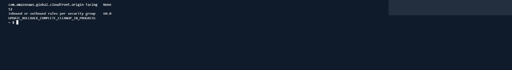

**Figure 101** · correctif : une seule règle CloudFront (HTTP 80), surveillance et bascule DNS via CloudFront, cfn-lint sans erreur

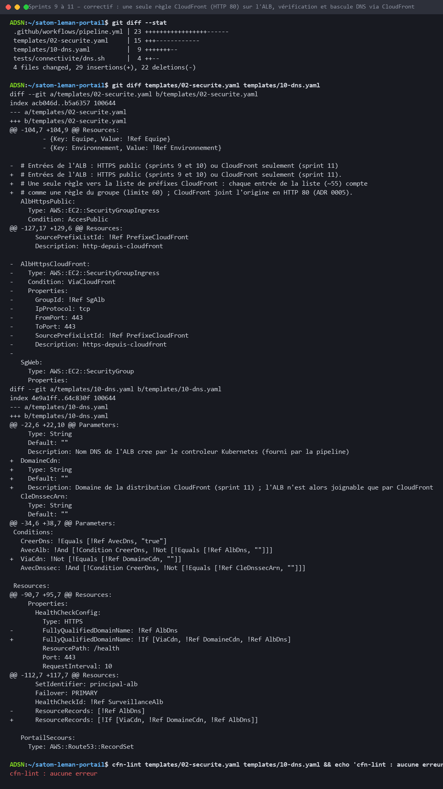

**Figure 102** · pull request #31 du correctif

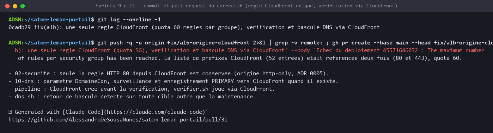

**Figure 103** · #31 fusionnée, exécution automatique annulée, relance confirmée du déploiement (#29 et #30 à remettre à jour avec main)

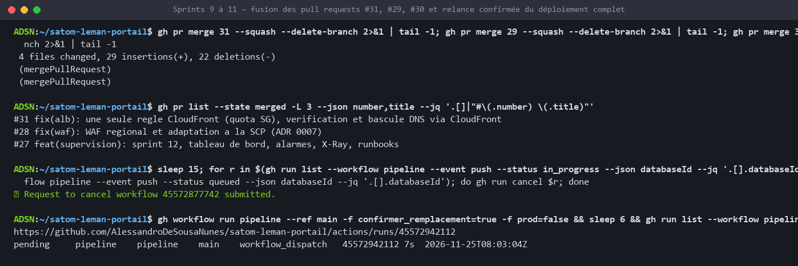

**Figure 104** · 2e essai : pile securite encore en nettoyage après le retour arrière, jeu de modifications refusé

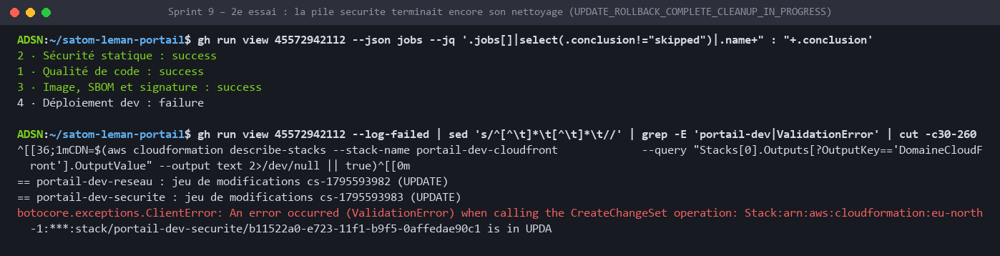

**Figure 105** · pull request #32 : tests via CloudFront, jeton d'exemption WAF, attente des piles ; cfn-lint, checkov, tests verts

**Figure 106** · pull request #32 fusionnée, exécution automatique annulée

**Figure 107** · CloudShell (administrateur) : rôle de la pipeline mis à jour (lecture du seul jeton de charge), sans remplacement

**Figure 108** · 3e lancement du déploiement complet de dev

**Figure 109** · 3e essai : réseau, sécurité, NAT à jour ; la pile EKS revient en arrière

**Figure 110** · cause : le groupe de nœuds ne peut pas vérifier le rôle lié au service AWSServiceRoleForAmazonEKSNodegroup

**Figure 111** · diagnostic : la politique du rôle autorise (simulateur IAM), le refus vient de la SCP ; le rôle lié au service n'existe pas

**Figure 112** · état du compte de la classe (lecture seule) : aucun cluster EKS ni nœud Kubernetes ; seul le rôle lié au service AWSServiceRoleForAmazonEKS existe, créé le 24.11 par la pipeline

**Figure 113** · administrateur (CloudShell), avec l'accord de l'étudiant : création du rôle lié au service AWSServiceRoleForAmazonEKSNodegroup

**Figure 114** · quota vCPU du compte partagé : 62 utilisés sur 64, il en faut 4 pour les deux nœuds

**Figure 115** · pull request #34 : un nœud t3.medium en dev, ADR 0008

**Figure 116** · 4e lancement du déploiement complet de dev

**Figure 117** · 08:51 : piles réseau à jour, la pipeline aborde la pile EKS

**Figure 118** · 08:53 : cluster eks-portail-dev-ADSN (Kubernetes 1.34) en création ; dépôt ECR, journaux et rôles IAM créés

**Figure 119** · 09:01 cluster ACTIVE, 09:03 nœud t3.medium ACTIVE (AL2023), Kubernetes 1.34, secrets chiffrés KMS

**Figure 120** · 4e essai : copie ECR refusée en relecture, droit ecr:GetDownloadUrlForLayer ajouté (pull request #36)

**Figure 121** · #36 et #35 fusionnées, exécutions automatiques annulées

**Figure 122** · 5e lancement du déploiement complet de dev

**Figure 123** · administrateur (CloudShell) : rôle de la pipeline mis à jour (lecture ECR), sans remplacement

**Figure 124** · moindre privilège : le rôle de console (CloudShell) n'a pas d'entrée d'accès au cluster ; seul le rôle OIDC de la pipeline administre Kubernetes

**Figure 125** · 09:40 : ALB alb-dev-leman-ADSN actif, 4 cibles saines (2 pods web, 2 pods api) ; piles CloudFront, WAF, DNS, supervision créées

**Figure 126** · pipeline #96 : étapes 1 à 4 vertes, déploiement complet de dev réussi, tests dynamiques en cours

**Figure 127** · résumé du déploiement : ALB et URL CloudFront publiés, artefacts SBOM et couverture

**Figure 128** · journal du déploiement réussi : piles, helm, checkov (188 contrôles), rollout web et api, CloudFront, fichiers statiques

**Figure 129** · mesure EKS (rôle OIDC) : cluster 1.34 chiffré, nœud Ready, Pod Security restricted, 4 pods au digest signé, conteneurs durcis, NetworkPolicy ; écouteurs non listés (corrigé)

**Figure 130** · mesure EKS réussie : écouteurs TLS 1.3/1.2, accès direct à l'ALB refusé, portail vérifié par CloudFront (9 contrôles OK)

## Sprint 10 · Route 53

**Figure 131** · pull request #25 (Route 53, DNSSEC, bascule) verte puis fusionnée

**Figure 132** · pull requests empilées : #25 (dns) et #26 (cdn) fusionnées dans main, #27 (supervision) intégrée à la branche du sprint 11

**Figure 133** · historique de main après résolution du conflit dû aux fusions squash

**Figure 134** · mesure Route 53 : CNAME vers CloudFront, résolution moyenne 38,5 ms (objectif < 100 ms) ; arrêt sur DNSSEC non activé (corrigé)

**Figure 135** · mesure Route 53 réussie : résolution moyenne 23,7 ms (< 100 ms), surveillance d'état 200 depuis les sondes Route 53, 0 adresse privée publiée, DNSSEC non signé (ADR 0007)

**Figure 136** · bascule DNS réussie : web à 0 réplique à 14:06:35, Route 53 bascule vers la maintenance en 50 s (< 60 s), retour sur CloudFront en 40 s

## Sprint 11 · CloudFront et WAF

**Figure 137** · la sécurité bloque la PR #26 : écriture IAM sans restriction (CKV_AWS_111) ; correctif : droits limités aux ressources du compte

**Figure 138** · pull request #26 verte après correction puis fusionnée (le sprint 12 y avait été intégré)

**Figure 139** · portail-bootstrap aligné sur main, rôle de la pipeline resserré sans remplacement

**Figure 140** · adaptation à la SCP : WAF régional sur l'ALB, retrait d'us-east-1, ADR 0007 ; commit et pull request #28

**Figure 141** · pull request #28 verte, fusion, relance confirmée du déploiement complet

**Figure 142** · CloudFront répond 504 : le SG autorise 80 depuis CloudFront, mais la NACL publique n'accepte que 443 en entrée

**Figure 143** · pull request #37 : règle NACL 105 (HTTP 80) pour l'origine CloudFront

**Figure 144** · #37 fusionnée, 6e lancement du déploiement complet

**Figure 145** · le portail répond par CloudFront : pages et API en 200, en-têtes de sécurité, x-cache

**Figure 146** · le portail dev dans le navigateur via CloudFront (version = commit déployé)

**Figure 147** · l'API /api/portefeuilles via CloudFront

**Figure 148** · premier scan OWASP ZAP via CloudFront : 0 alerte élevée, 3 avertissements

**Figure 149** · correctifs : vérification réelle (verifier.sh, pipefail), en-têtes CSP base-uri, object-src et COEP

**Figure 150** · #38 fusionnée, pipeline relancée automatiquement sur main

**Figure 151** · /static/portail.css en 403, dernier avertissement ZAP

**Figure 152** · pull request #40 : la clé KMS autorise CloudFront (OAC), dns.sh corrigé

**Figure 153** · #39 et #40 fusionnées, pipeline relancée sur main

**Figure 154** · mesure CloudFront réussie : taux de cache statique 100 % (> 80 %), API jamais en cache, HTTP→HTTPS 301, ALB injoignable hors CloudFront

**Figure 155** · 1re mesure WAF : 700 requêtes en rafale non bloquées (la limitation agit avec retard)

**Figure 156** · autocritique : HEAD en cache masquait un 403 en GET ; déploiement automatique refusé (remplacement conditionnel) ; mesures corrigées

**Figure 157** · #41 fusionnée, déploiement relancé avec confirmation

**Figure 158** · ZAP 0 alerte (66 PASS), k6 SLO respectés : p95 134 ms, p99 237 ms, 0 % d'erreur sur 7998 requêtes ; Lighthouse en erreur Chrome (NO_NAVSTART)

**Figure 159** · mesure CloudFront : retour à la ligne parasite dans le script awk (corrigé)

**Figure 160** · mesure réussie : cache statique 100 % (GET 200), HTTP→HTTPS, ALB injoignable hors CloudFront ; WAF : 1er blocage 403 après 2401 requêtes en 26 s (limite 500/5 min par IP)

## Sprint 12 · supervision et conformité

**Figure 161** · état en lecture seule du compte de la classe : Security Hub non souscrit, aucun détecteur GuardDuty, aucun enregistreur AWS Config

**Figure 162** · secret ALERTE_EMAIL ajouté, adresse absente du dépôt

**Figure 163** · pull request #35 : injection de panne pour le test d'alarme, 21 tests verts

**Figure 164** · sujet SNS du portail : abonnement e-mail en attente de confirmation ; 3 alarmes (5xx, latence p95, cibles non saines) à OK

**Figure 165** · mail de demande de confirmation SNS reçu (25.11, 10:07), numéro de compte masqué

**Figure 166** · abonnement e-mail au sujet SNS confirmé par l'exploitant (compte et identifiants masqués)

**Figure 167** · test d'alarme : erreurs 5xx des cibles à partir de 13:29-13:30 UTC (75-80 / min), alarme portail-dev-alb-5xx en ALARM à 13:33:52

**Figure 168** · mail ALARM reçu par l'exploitant le 25.11 à 14:33 (heure suisse) = 13:33 UTC, même minute que le passage en ALARM (compte masqué)

**Figure 169** · test de bout en bout réussi : panne 13:29:30, ALARM 13:33:52 (4 min 22 s), mail reçu à 13:33 UTC (< 5 min), retour à OK 13:42:52

**Figure 170** · #42 et #43 fusionnées, déploiement relancé

**Figure 171** · mail OK reçu le 25.11 à 14:42 (heure suisse) = 13:42:52 UTC, retour à la normale notifié (compte masqué)

## Sprint 13 · reprise après sinistre

**Figure 172** · pull request : suppression complète de dev depuis le dépôt (workflow reprise), seuils Lighthouse

**Figure 173** · #34 et #33 fusionnées, exécutions automatiques annulées

**Figure 174** · administrateur (CloudShell) : rôle de la pipeline mis à jour (versions d'objets du bucket statique), sans remplacement

## Documentation · journal, ADR, indicateurs DORA

**Figure 175** · journal du 24.11 (incidents, gouvernance, DORA) et ADR 0006 (sprint 4 reporté pour incident AWS)

**Figure 176** · pull request #29 : journal du 24.11, DORA, ADR 0006

**Figure 177** · pull request #30 : publication des captures masquées

