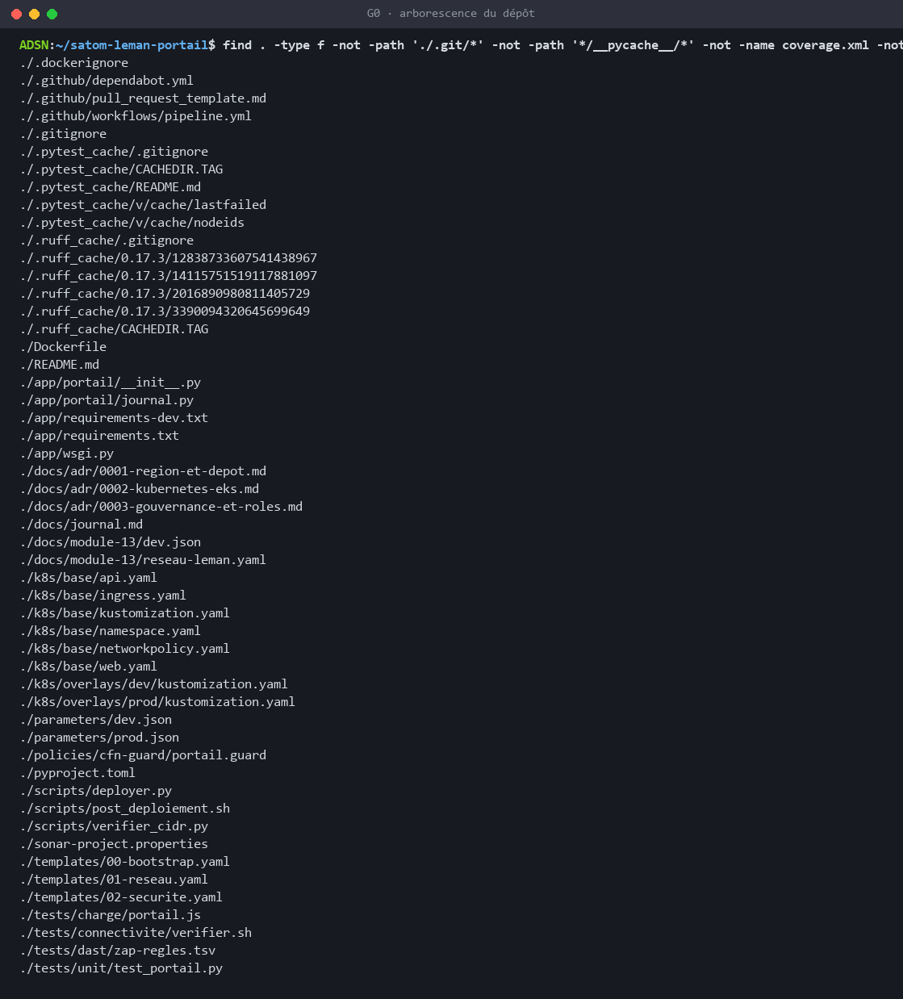
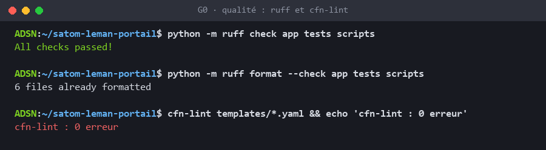
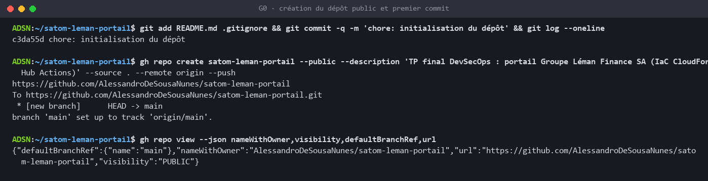
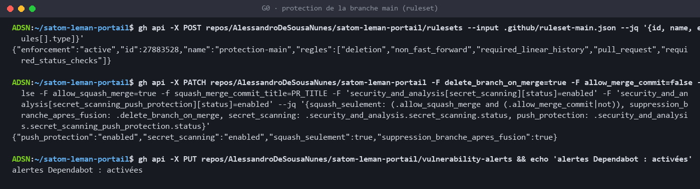
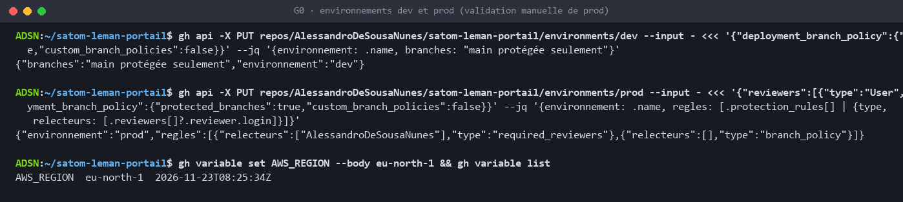
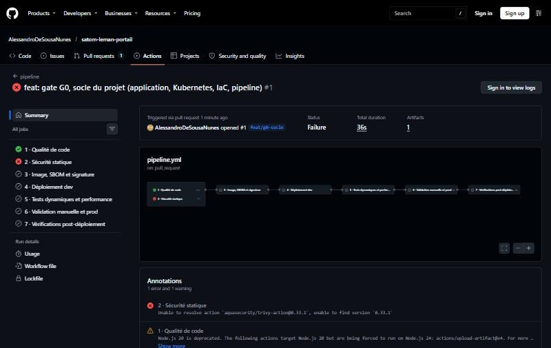
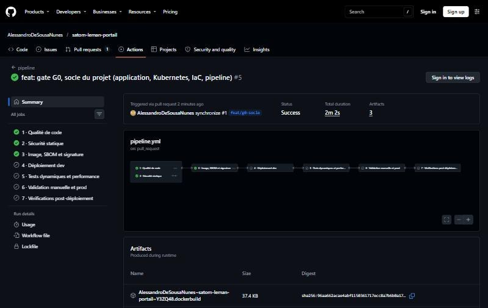
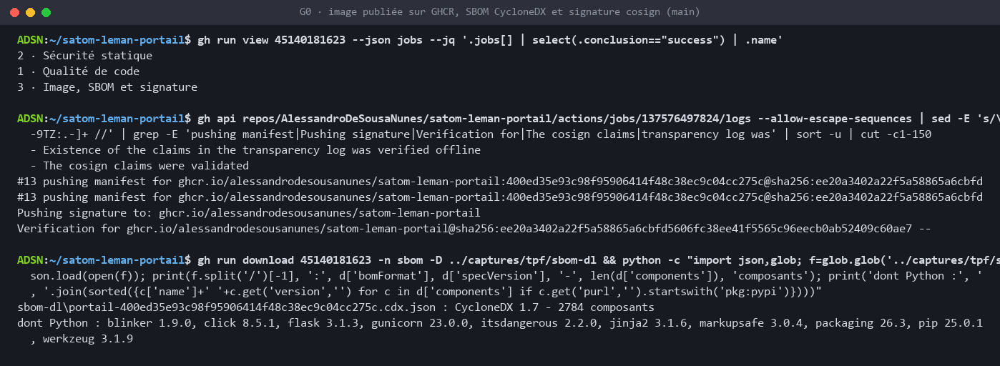
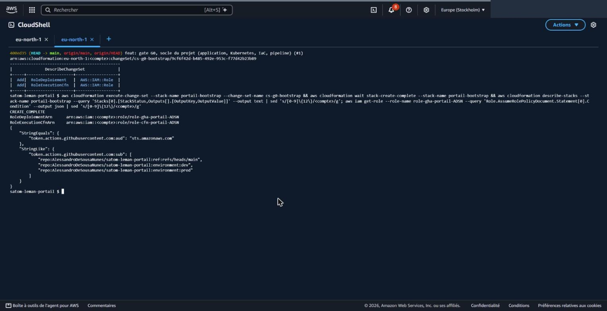
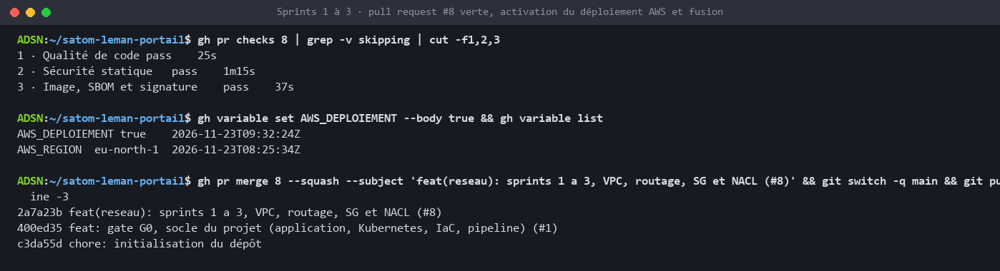

# Captures du TP final

Chaque étape est réalisée en ligne de commande (poste, GitHub CLI, CloudShell) ou par la pipeline.
Le numéro de compte AWS est masqué sur toutes les captures.

## Gate G0 · socle du projet (dépôt, pipeline, OIDC)

**Figure 1** · arborescence du dépôt : templates, parameters, policies, app, k8s, tests, scripts, sbom, docs, .github/workflows

**Figure 2** · 18 tests unitaires verts, couverture 97,9 % (seuil 80 %)

**Figure 3** · qualité : ruff (lint et format) et cfn-lint sans erreur

**Figure 4** · sécurité statique en local : checkov 285 contrôles réussis (CloudFormation, Kubernetes, Dockerfile), aucun chevauchement de CIDR

**Figure 5** · création du dépôt public AlessandroDeSousaNunes/satom-leman-portail avec gh et premier commit

**Figure 6** · protection de main : ruleset (pull request, historique linéaire, 3 vérifications obligatoires), secret scanning et push protection, alertes Dependabot

**Figure 7** · environnements dev et prod, prod soumis à la validation manuelle d'AlessandroDeSousaNunes

**Figure 8** · branche feat/g0-socle, 5 commits au format Conventional Commits, push

**Figure 9** · première exécution : qualité verte, sécurité en échec (version de l'action Trivy introuvable), étapes suivantes bloquées

**Figure 10** · correction : versions publiées des actions GitHub, commit fix(ci)

**Figure 11** · SCA : pip-audit bloque la pipeline sur Flask 3.1.2 (PYSEC-2026-2151), passage en 3.1.3, plus aucune vulnérabilité

**Figure 12** · pull request #1 : étapes 1 à 3 vertes (qualité, sécurité statique, image + SBOM), 3 artefacts ; étapes 4 à 7 réservées à main

**Figure 13** · vérifications de la pull request #1 au vert puis fusion squash dans main

**Figure 14** · exécution sur main après fusion : étapes 1 à 3 vertes, étapes AWS en attente de la variable AWS_DEPLOIEMENT

**Figure 15** · image publiée sur ghcr.io, signature cosign vérifiée (journal de transparence), SBOM CycloneDX de 2784 composants

**Figure 16** · jeu de modifications de la pile portail-bootstrap : 2 rôles IAM ajoutés (fournisseur OIDC GitHub existant réutilisé)

**Figure 17** · portail-bootstrap CREATE_COMPLETE : role-gha-portail-ADSN limité au dépôt (main, environnements dev et prod) et role-cfn-portail-ADSN

**Figure 18** · diagnostic : fournisseur OIDC GitHub du compte correct (audience sts.amazonaws.com)

**Figure 19** · correction : le rôle accepte le claim sub avec identifiants immuables (propriétaire@260914278, dépôt@1468484199), mise à jour sans remplacement

## Nettoyage du labo de la semaine (avant le TP final)

**Figure 20** · inventaire avant : ressources ADSN encore actives depuis vendredi (NAT, TGW, VPN, pare-feu, 2 ALB, instances, zones, CloudFront)

**Figure 21** · essai à blanc : uniquement des ressources étiquetées Equipe=ADSN, aucune ressource d'une autre équipe

**Figure 22** · journal du script : suppression dans l'ordre des dépendances

**Figure 23** · inventaire après : toutes les ressources ADSN supprimées sauf le pare-feu (erreur interne AWS, nouvelle tentative toutes les 2 minutes), budget conservé

## Sprints 1 à 3 · VPC, routage, Security Groups et NACL

**Figure 24** · pull request #8 verte, activation du déploiement AWS (AWS_DEPLOIEMENT=true) et fusion

**Figure 25** · étape 4 de la pipeline : piles dev créées par jeux de modifications (réseau, sécurité, sortie Internet), étape 6 en attente de validation

**Figure 26** · étape 6 : mise en prod refusée par le relecteur, reportée au sprint 13 (la porte d'approbation fonctionne)

**Figure 27** · mesure : describe-subnets sur vpc-portail-dev-ADSN, sous-réseaux publics et privés sur deux zones, sub-public-1b en 10.10.5.0/24, aucune IP publique automatique

**Figure 28** · mesure : table privée sans route vers l'IGW, groupes de sécurité (SSH seulement depuis la salle, 8080 seulement depuis sg-web), NACL

